# SƠ ĐỒ HOẠT ĐỘNG (ACTIVITY DIAGRAM)
## USE CASE: KHÁCH HÀNG THANH TOÁN ĐƠN HÀNG (`uc003-checkout`)

---

## 1. GIỚI THIỆU & NGUYÊN TẮC MÔ HÌNH HÓA

Sơ đồ Hoạt động (Activity Diagram) dưới đây mô tả chi tiết chuỗi hành động và tương tác phân làn (Swimlane) giữa **Khách hàng (Customer)** và **Hệ thống PinkyCloud** trong quy trình Đặt hàng & Thanh toán (Checkout). Quy trình bao quát từ việc xác thực bảo mật tài khoản `ROLE_CUSTOMER`, kiểm tra giỏ hàng trong `HttpSession` (`SESSION_CART`), kiểm tra tính hợp lệ dữ liệu biểu mẫu giao nhận theo tiêu chuẩn Bean Validation JSR-380, kiểm tra tồn kho CSDL, thực thi Transaction trừ tồn kho và tăng số lượng bán, tạo thực thể `Order` và `OrderItem`, làm sạch giỏ hàng trong Session, đến việc kích hoạt phát sự kiện `OrderPlacedEvent` gửi email xác nhận bất đồng bộ `@Async` sau khi commit giao dịch.

- **Nguồn chân lý (Source of Truth):** Đặc tả ca sử dụng chi tiết [`docs/usecases/uc003-checkout.md`](file:///E:/java-www/www-programming/docs/usecases/uc003-checkout.md).
- **Mức độ bao phủ:** Phản ánh chính xác 1-1 Luồng sự kiện chính (Main Flow - các bước 1 đến 11), Luồng thay thế (Alternate Flow - 4.1, 11.1) và toàn bộ các Luồng ngoại lệ (Exception Flows - 2.1.1, 2.2.1, 5.1.1, 5.2.1, 6.1.1, 6.2.1, 8.1.1, 10.1.1) kèm các vòng lặp điều chỉnh dữ liệu.

---

## 2. SƠ ĐỒ SWIMLANE ACTIVITY DIAGRAM (MERMAID UML)

```mermaid
flowchart TD
    %% =========================================================================
    %% LÀN 1: KHÁCH HÀNG (CUSTOMER)
    %% =========================================================================
    subgraph Customer_Lane["Khách hàng (Customer)"]
        Start(((Bắt đầu)))
        A1(["1. Nhấn nút 'Tiến Hành Đặt Hàng' trên giỏ hàng<br>(hoặc chuyển hướng từ 'Mua Ngay')"])
        A4(["4. Điền thông tin giao hàng & thanh toán:<br>• Họ tên người nhận (recipientName)<br>• SĐT nhận hàng (recipientPhone)<br>• Địa chỉ nhận hàng (shippingAddress)<br>• Phương thức thanh toán (paymentMethod: COD/BANKING)<br>• Ghi chú đơn hàng (note)"])
        D_FormAction{"Khách hàng chọn thao tác?"}
    end

    %% =========================================================================
    %% LÀN 2: HỆ THỐNG PINKYCLOUD (SYSTEM)
    %% =========================================================================
    subgraph System_Lane["Hệ thống PinkyCloud"]
        %% Giai đoạn 1: Mở form & Kiểm tra phiên / quyền
        D_Auth{"Xác thực phiên & quyền<br>ROLE_CUSTOMER hợp lệ?"}
        A2_1_2(["2.1.2. Chặn yêu cầu, lưu SavedRequest<br>& Redirect 302 /login"])
        End_Auth(((Kết thúc: Yêu cầu đăng nhập)))

        A2_CheckCart(["2. Trích xuất CartDTO từ HttpSession (SESSION_CART)"])
        D_CartEmpty{"Giỏ hàng rỗng<br>(cart == null || cart.isEmpty)?"}
        A2_2_2(["2.2.2. Nạp flash errorMessage: 'Giỏ hàng đang trống!'<br>& Redirect 302 /cart"])
        End_EmptyCart(((Kết thúc: Giỏ trống)))

        A3_ShowForm(["3. Nạp sẵn thông tin tài khoản từ UserRepository.findByEmail,<br>đưa cart và checkoutRequest vào Model,<br>render view checkout/checkout-form.html"])

        %% Giai đoạn 2: Tiếp nhận Submit hoặc Quay lại giỏ
        A4_2_Back(["4.2. Chuyển hướng người dùng về màn hình giỏ hàng<br>HTTP 302 Redirect to /cart"])
        End_Back(((Kết thúc: Quay lại giỏ)))

        A5_PostCheckout(["5. Tiếp nhận POST /checkout,<br>kiểm tra giỏ hàng Session & Bean Validation JSR-380"])
        D_CartEmptySubmit{"Giỏ hàng còn sản phẩm?"}
        A5_1_2(["5.1.2. Nạp flash errorMessage: 'Giỏ hàng của bạn đang trống!'<br>& Redirect 302 /cart"])

        D_JSR380{"Dữ liệu hợp lệ Bean Validation JSR-380?<br>(Tên <=100 ký tự, SĐT regex VN,<br>Địa chỉ <=255 ký tự, Note <=500 ký tự)"}
        A5_2_2(["5.2.2. Giữ nguyên dữ liệu vừa nhập, nạp cart vào Model<br>& render form kèm thông báo lỗi inline màu đỏ"])

        %% Giai đoạn 3: Thực thi Transaction đặt hàng & Kiểm tra tồn kho
        A6_LoopCheck(["6. Giao dịch @Transactional: Duyệt CartItemDTO,<br>truy vấn ProductRepository.findByIdAndActiveTrue"])
        D_ProdValid{"Sản phẩm tồn tại &<br>đang mở bán (active = true)?"}
        A6_1_2(["6.1.2. Ném IllegalArgumentException: 'Sản phẩm không còn khả dụng!'<br>-> Tự động Rollback Transaction"])

        D_StockAvailable{"Số lượng mua (quantity) <=<br>tồn kho khả dụng (stockQuantity)?"}
        A6_2_2(["6.2.2. Ném IllegalArgumentException: 'Sản phẩm không đủ tồn kho!'<br>-> Tự động Rollback Transaction"])

        %% Giai đoạn 4: Trừ kho, Tăng soldCount & Ghi nhận CSDL
        A7_UpdateStock(["7. Trừ tồn kho: product.stockQuantity -= item.quantity,<br>tăng soldCount: product.soldCount += item.quantity,<br>lưu ProductRepository.save(product)"])
        A8_SaveOrder(["8. Sinh mã orderCode (ORDyyXXXXXX), tạo Order & OrderItem,<br>thiết lập quan hệ hai chiều & lưu OrderRepository.save(order)"])

        D_DBInsert{"Thực thi lệnh INSERT CSDL<br>thành công?"}
        A8_1_2(["8.1.2. Bắt lỗi DataAccessException/DB Error,<br>Rollback Transaction toàn bộ & hiển thị lỗi hệ thống"])

        %% Giai đoạn 5: Xóa giỏ Session, Phát sự kiện & Gửi mail
        A9_ClearCart(["9. Làm sạch giỏ hàng trong Session: cartService.clearCart(session)"])
        A10_CommitAndEvent(["10. Commit Transaction CSDL thành công.<br>Phát sự kiện OrderPlacedEvent qua ApplicationEventPublisher"])

        A10_AsyncMail(["10. Listener OrderMailListener nhận sự kiện tại AFTER_COMMIT,<br>gọi OrderMailService.sendOrderConfirmation chạy @Async('welcomeMailExecutor')"])
        D_MailStatus{"Gửi email SMTP thành công?"}
        A10_1_2(["10.1.2. Ghi log cảnh báo TaskRejectedException / MailException,<br>không ảnh hưởng tới đơn hàng"])
        A10_MailOK(["Gửi email xác nhận đơn hàng thành công đến hộp thư khách hàng"])

        %% Giai đoạn 6: PRG Redirect sang trang Success
        A11_PRG(["11. Nạp flash attributes (orderCode, order, successMessage)<br>& chuyển hướng HTTP 302 Redirect to /checkout/success"])
        A11_RenderSuccess(["11. Tiếp nhận GET /checkout/success,<br>render view checkout/order-success.html"])
        End_Success(((Kết thúc: Đặt hàng thành công)))
    end

    %% =========================================================================
    %% LUỒNG ĐIỀU KHIỂN VÀ RẼ NHÁNH (CONTROL FLOWS)
    %% =========================================================================
    Start --> A1
    A1 --> D_Auth

    %% Kiểm tra Auth
    D_Auth -->|"Chưa đăng nhập (2.1.1)"| A2_1_2
    A2_1_2 --> End_Auth
    D_Auth -->|"Đã đăng nhập ROLE_CUSTOMER"| A2_CheckCart

    %% Kiểm tra Giỏ hàng mở Form
    A2_CheckCart --> D_CartEmpty
    D_CartEmpty -->|"Giỏ hàng rỗng (2.2.1)"| A2_2_2
    A2_2_2 --> End_EmptyCart
    D_CartEmpty -->|"Giỏ có sản phẩm"| A3_ShowForm

    %% Mở form cho khách hàng nhập liệu
    A3_ShowForm --> A4
    A4 --> D_FormAction

    %% Rẽ nhánh thao tác form
    D_FormAction -->|"4.1. Nhấn '← Quay lại giỏ hàng'"| A4_2_Back
    A4_2_Back --> End_Back
    D_FormAction -->|"Nhấn 'Xác Nhận Đặt Hàng'"| A5_PostCheckout

    %% Kiểm tra giỏ khi submit POST
    A5_PostCheckout --> D_CartEmptySubmit
    D_CartEmptySubmit -->|"Giỏ rỗng khi submit (5.1.1)"| A5_1_2
    A5_1_2 --> End_EmptyCart
    D_CartEmptySubmit -->|"Giỏ hợp lệ"| D_JSR380

    %% Kiểm tra JSR-380
    D_JSR380 -->|"Vi phạm ràng buộc (5.2.1)"| A5_2_2
    A5_2_2 -.->|"5.2.3. Sửa lại thông tin giao hàng"| A4
    D_JSR380 -->|"Form hợp lệ"| A6_LoopCheck

    %% Thực thi kiểm tra nghiệp vụ & Tồn kho trong Transaction
    A6_LoopCheck --> D_ProdValid
    D_ProdValid -->|"Sản phẩm bị vô hiệu hóa (6.1.1)"| A6_1_2
    A6_1_2 -.->|"6.1.3. Báo lỗi và quay lại form"| A4
    D_ProdValid -->|"Sản phẩm hợp lệ"| D_StockAvailable

    D_StockAvailable -->|"Vượt tồn kho (6.2.1)"| A6_2_2
    A6_2_2 -.->|"6.2.3. Báo lỗi kho và quay lại form"| A4
    D_StockAvailable -->|"Tồn kho đáp ứng"| A7_UpdateStock

    %% Lưu DB
    A7_UpdateStock --> A8_SaveOrder
    A8_SaveOrder --> D_DBInsert

    D_DBInsert -->|"Lỗi CSDL / Rollback (8.1.1)"| A8_1_2
    A8_1_2 -.->|"8.1.3. Báo lỗi hệ thống"| A4
    D_DBInsert -->|"Lưu CSDL thành công"| A9_ClearCart

    %% Dọn giỏ, Commit và Gửi mail Async
    A9_ClearCart --> A10_CommitAndEvent
    A10_CommitAndEvent --> A10_AsyncMail
    A10_AsyncMail --> D_MailStatus
    D_MailStatus -->|"Quá tải / Lỗi SMTP (10.1.1)"| A10_1_2
    D_MailStatus -->|"Gửi mail thành công"| A10_MailOK

    %% PRG sang kết quả
    A10_CommitAndEvent --> A11_PRG
    A11_PRG --> A11_RenderSuccess
    A11_RenderSuccess --> End_Success
```

---

## 3. BẢNG GIẢI THÍCH CHI TIẾT CÁC ĐIỂM RẼ NHÁNH & NGOẠI LỆ

| Điểm Rẽ Nhánh (Decision) | Điều Kiện Kiểm Tra | Hành Động Xử Lý & Phản Hồi Hệ Thống | Luồng Tương Ứng trong Đặc Tả |
| :--- | :--- | :--- | :--- |
| **`D_Auth`** | Kiểm tra phiên đăng nhập và quyền truy cập `ROLE_CUSTOMER` của người dùng. | **Chưa đăng nhập (2.1.1):** Spring Security chặn request, lưu `SavedRequest` và chuyển hướng `HTTP 302 Redirect to /login`. **Đã đăng nhập:** Tiếp tục cho phép request tiến vào Controller. | Ngoại lệ `2.1.1` $\rightarrow$ `2.1.2` $\rightarrow$ `2.1.3` |
| **`D_CartEmpty`** | Kiểm tra trạng thái rỗng của giỏ hàng khi người dùng mở trang thanh toán (`GET /checkout`). | **Giỏ rỗng (2.2.1):** Nạp flash attribute `errorMessage`: *"Giỏ hàng đang trống! Vui lòng chọn sản phẩm trước khi thanh toán."*, redirect về `/cart`. **Có sản phẩm:** Nạp thông tin người dùng và hiển thị form thanh toán. | Ngoại lệ `2.2.1` $\rightarrow$ `2.2.2` |
| **`D_FormAction`** | Lựa chọn hành vi của Khách hàng trên biểu mẫu thanh toán. | **Quay lại giỏ hàng (4.1):** Hủy thao tác thanh toán, redirect về `/cart`. **Xác nhận đặt hàng:** Gửi form `POST /checkout` lên máy chủ. | Luồng thay thế `4.1` $\rightarrow$ `4.2` |
| **`D_CartEmptySubmit`** | Kiểm tra giỏ hàng có bị làm trống hoặc mất phiên trong lúc đang mở form thanh toán. | **Giỏ rỗng (5.1.1):** Nạp flash attribute `errorMessage`: *"Giỏ hàng của bạn đang trống!"*, redirect về `/cart`. **Hợp lệ:** Tiếp tục kiểm tra validation form. | Ngoại lệ `5.1.1` $\rightarrow$ `5.1.2` |
| **`D_JSR380`** | Xác thực dữ liệu đầu vào `CheckoutRequestDTO` theo các ràng buộc JSR-380. | **Vi phạm (5.2.1):** Họ tên rỗng/quá 100 ký tự; Số điện thoại sai định dạng VN; Địa chỉ rỗng/quá 255 ký tự; Ghi chú quá 500 ký tự. Giữ lại form, hiển thị thông báo lỗi màu đỏ inline. **Hợp lệ:** Bắt đầu Transaction đặt hàng tại Service. | Ngoại lệ `5.2.1` $\rightarrow$ `5.2.2` $\rightarrow$ `5.2.3` (Quay lại Bước 4) |
| **`D_ProdValid`** | Kiểm tra sản phẩm còn khả dụng trong CSDL (`findByIdAndActiveTrue`). | **Bị vô hiệu hóa / Không tìm thấy (6.1.1):** Ném `IllegalArgumentException("Sản phẩm '[tên]' không còn khả dụng!")`, tự động Rollback Transaction, nạp lỗi vào Model và hiển thị lại form. **Hợp lệ:** Tiếp tục kiểm tra tồn kho. | Ngoại lệ `6.1.1` $\rightarrow$ `6.1.2` $\rightarrow$ `6.1.3` (Quay lại Bước 4) |
| **`D_StockAvailable`** | So sánh số lượng đặt mua với số lượng tồn kho thực tế (`item.quantity <= product.stockQuantity`). | **Không đủ tồn kho (6.2.1):** Ném `IllegalArgumentException("Sản phẩm '[tên]' không đủ số lượng trong kho...")`, tự động Rollback Transaction, không trừ kho, giữ nguyên giỏ hàng, nạp lỗi vào Model. **Tồn kho đáp ứng:** Trừ tồn kho, tăng số lượng bán và chuẩn bị ghi nhận CSDL. | Ngoại lệ `6.2.1` $\rightarrow$ `6.2.2` $\rightarrow$ `6.2.3` (Quay lại Bước 4) |
| **`D_DBInsert`** | Kiểm tra tính toàn vẹn khi thực thi INSERT bảng `orders` và `order_items`. | **Lỗi CSDL (8.1.1):** Tự động Rollback Transaction toàn diện qua `@Transactional(rollbackFor = Exception.class)`, bảo toàn tồn kho và giỏ hàng, hiển thị thông báo lỗi hệ thống. **Thành công:** Lưu thành công đơn hàng và chi tiết đơn hàng xuống CSDL. | Ngoại lệ `8.1.1` $\rightarrow$ `8.1.2` $\rightarrow$ `8.1.3` & Luồng chính Bước 8 |
| **`D_MailStatus`** | Trạng thái gửi email thông báo xác nhận đơn hàng tại `@Async` listener. | **Lỗi SMTP / Hàng đợi đầy (10.1.1):** Bắt `TaskRejectedException` hoặc lỗi gửi mail, ghi log cảnh báo; không làm hỏng đơn hàng do sự kiện thực thi tại pha `AFTER_COMMIT`. **Thành công:** Khách hàng nhận được email xác nhận đơn hàng kèm thông tin chi tiết. | Ngoại lệ `10.1.1` $\rightarrow$ `10.1.2` $\rightarrow$ `10.1.3` & Luồng chính Bước 10, 11 |
