# SƠ ĐỒ HOẠT ĐỘNG (ACTIVITY DIAGRAM)
## PHÂN HỆ GIỎ HÀNG: THÊM & QUẢN LÝ GIỎ HÀNG (`uc002a-customer-add-to-cart` & `uc002b-customer-manage-cart`)

---

## 1. GIỚI THIỆU & NGUYÊN TẮC MÔ HÌNH HÓA

Sơ đồ Hoạt động (Activity Diagram) dưới đây mô tả chi tiết chuỗi hành động và tương tác phân làn (Swimlane) giữa **Khách hàng / Khách vãng lai (Customer / Guest)** và **Hệ thống PinkyCloud** trong hai ca sử dụng thành phần của Phân hệ Giỏ hàng:
1. **Thêm sản phẩm vào giỏ hàng (`uc002a-customer-add-to-cart`):** Thêm vào giỏ từ chi tiết sản phẩm / danh mục, kiểm tra mở bán, kiểm tra tồn kho và hỗ trợ luồng "Mua ngay" chuyển thẳng tới thanh toán.
2. **Xem và cập nhật giỏ hàng (`uc002b-customer-manage-cart` / `uc002-shopping-cart`):** Xem giỏ hàng phiên làm việc, điều chỉnh số lượng, kiểm tra tồn kho, xóa từng món hoặc làm trống toàn bộ giỏ hàng.

- **Nguồn chân lý (Source of Truth):**
  - Đặc tả ca sử dụng [`docs/usecases/uc002a-customer-add-to-cart.md`](file:///E:/java-www/www-programming/docs/usecases/uc002a-customer-add-to-cart.md).
  - Đặc tả ca sử dụng [`docs/usecases/uc002b-customer-manage-cart.md`](file:///E:/java-www/www-programming/docs/usecases/uc002b-customer-manage-cart.md) (tương đương [`docs/usecases/uc002-shopping-cart.md`](file:///E:/java-www/www-programming/docs/usecases/uc002-shopping-cart.md)).
- **Mức độ bao phủ:** Phản ánh chính xác 1-1 Luồng sự kiện chính, các Luồng thay thế (Mua ngay, Giỏ trống, Xóa từng món, Xóa tất cả, Đặt hàng) và toàn bộ các Luồng ngoại lệ kèm các vòng lặp điều chỉnh dữ liệu.

---

## 2. SƠ ĐỒ SWIMLANE ACTIVITY DIAGRAM (MERMAID UML)

```mermaid
flowchart TD
    %% =========================================================================
    %% LÀN 1: KHÁCH HÀNG / KHÁCH VÃNG LAI (CUSTOMER / GUEST)
    %% =========================================================================
    subgraph Customer_Lane["Khách hàng / Khách vãng lai (Customer / Guest)"]
        Start(((Bắt đầu)))
        A1(["1. Xem chi tiết sản phẩm / danh mục,<br>chọn số lượng mua (mặc định quantity = 1)"])
        D_ActionAdd{"Khách hàng chọn thao tác?"}
        
        A_ViewCartAction(["1. Nhấn vào biểu tượng giỏ hàng<br>hoặc truy cập URL /cart"])
        
        A3_Select["Khách hàng thao tác trên trang giỏ hàng"]
        D_CartOp{"Thao tác trên giỏ hàng?"}
        A3_Update(["3. Điều chỉnh số lượng (quantity) và nhấn 'Lưu'"])
        A3_1(["3.1. Nhấn nút thùng rác 'Xóa' một mặt hàng"])
        A3_3(["3.3. Nhấn nút 'Xóa tất cả' làm trống giỏ hàng"])
        A3_5(["3.5. Nhấn nút 'Tiến Hành Đặt Hàng'"])
    end

    %% =========================================================================
    %% LÀN 2: HỆ THỐNG PINKYCLOUD (SYSTEM)
    %% =========================================================================
    subgraph System_Lane["Hệ thống PinkyCloud"]
        %% USE CASE 1: THÊM SẢN PHẨM VÀO GIỎ HÀNG (uc002a)
        A2(["2. Tiếp nhận POST /cart/add,<br>kiểm tra Bean Validation (@Valid AddToCartRequestDTO)"])
        D_JSR380_Add{"Dữ liệu hợp lệ JSR-380?<br>(productId không rỗng & quantity >= 1)"}
        A2_1_2(["2.1.2. Nạp flash errorMessage: 'Số lượng mua phải từ 1 trở lên'<br>& Redirect 302 về trang trước (Referer)"])

        A3_Prod(["3. Truy vấn ProductRepository.findByIdAndActiveTrue(productId)"])
        D_ProdExist{"Sản phẩm tồn tại &<br>đang mở bán (active = true)?"}
        A3_1_2(["3.1.2. Bắt IllegalArgumentException: 'Sản phẩm không tồn tại hoặc đã ngừng kinh doanh'<br>& Redirect 302 về Referer"])

        A4_Stock(["4. Tính tổng số lượng yêu cầu: totalRequested = currentQty + requestQty<br>& so sánh với product.stockQuantity"])
        D_StockAdd{"totalRequested <= stockQuantity?"}
        A4_1_2(["4.1.2. Bắt IllegalArgumentException: 'Số lượng yêu cầu vượt quá tồn kho'<br>& Redirect 302 về Referer"])

        A5_SaveSession(["5. Đóng gói CartItemDTO, thêm vào giỏ CartDTO trong HttpSession (SESSION_CART),<br>tự động tính lại thành tiền và tổng tiền tạm tính"])
        D_AddType{"Tham số action hoặc redirect?"}
        A1_2_BuyNow(["1.2. Nhận diện action=buyNow (hoặc redirect=checkout),<br>Redirect 302 /checkout sang màn hình thanh toán"])
        A6_Flash(["6. Nạp flash successMessage: 'Đã thêm sản phẩm vào giỏ hàng thành công!'<br>& Redirect 302 về trang hiện tại (Referer)"])

        %% USE CASE 2: XEM VÀ CẬP NHẬT GIỎ HÀNG (uc002b)
        A2_Cart(["2. Tiếp nhận GET /cart, trích xuất CartDTO từ HttpSession (SESSION_CART)"])
        D_CartEmpty{"Giỏ hàng rỗng<br>(cart == null || cart.isEmpty)?"}
        A2_2_Empty(["2.2. Render cart/cart-view.html với khối empty-state-box:<br>'Giỏ hàng của bạn đang trống!' kèm nút 'Khám phá sản phẩm ngay'"])
        A2_Render(["2. Render cart/cart-view.html hiển thị danh sách sản phẩm,<br>đơn giá, số lượng, thành tiền, tổng tiền và nút Tiến hành đặt hàng"])

        %% Cập nhật số lượng
        A4_Valid(["4. Tiếp nhận POST /cart/update, kiểm tra validation (@Valid UpdateCartItemRequestDTO)"])
        D_JSR380_Update{"Dữ liệu hợp lệ JSR-380?<br>(quantity >= 1)"}
        A4_1_2(["4.1.2. Nạp flash errorMessage: 'Số lượng không hợp lệ!'<br>& Redirect 302 về /cart"])

        A5_CheckInCart(["5. Kiểm tra sản phẩm có trong giỏ hàng và kiểm tra tồn kho CSDL"])
        D_InCart{"Món hàng có trong giỏ?"}
        A5_1_2(["5.1.2. Nạp flash errorMessage: 'Sản phẩm không có trong giỏ hàng!'<br>& Redirect 302 về /cart"])

        D_StockUpdate{"quantity <= stockQuantity?"}
        A5_2_2(["5.2.2. Nạp flash errorMessage: 'Số lượng cập nhật vượt quá tồn kho'<br>& Redirect 302 về /cart giữ nguyên số lượng cũ"])

        A6_Success(["6. Cập nhật quantity và subtotal trong CartDTO,<br>lưu lại vào HttpSession (SESSION_CART),<br>nạp flash: 'Đã cập nhật số lượng thành công!' & Redirect 302 /cart"])

        %% Xóa món & Xóa toàn bộ
        A3_2_Remove(["3.2. Tiếp nhận POST /cart/remove, xóa item khỏi CartDTO trong Session,<br>nạp flash: 'Đã xóa sản phẩm khỏi giỏ hàng!' & Redirect 302 /cart"])
        A3_4_Clear(["3.4. Tiếp nhận POST /cart/clear, làm sạch items trong CartDTO (cart.clear),<br>nạp flash: 'Đã làm trống giỏ hàng!' & Redirect 302 /cart"])

        A3_6_Checkout(["3.6. Chuyển hướng sang Use Case uc003-checkout (HTTP 302 Redirect to /checkout)"])
        End_Shopping(((Kết thúc: Đã cập nhật giỏ)))
        End_CheckoutGo(((Chuyển sang Thanh toán)))
    end

    %% =========================================================================
    %% LUỒNG ĐIỀU KHIỂN VÀ RẼ NHÁNH (CONTROL FLOWS)
    %% =========================================================================
    Start --> A1
    A1 --> D_ActionAdd

    %% Nhánh Thao tác Thêm / Mua ngay (uc002a)
    D_ActionAdd -->|"Nhấn 'Thêm Vào Giỏ' (action=add)"| A2
    D_ActionAdd -->|"1.1. Nhấn 'Mua Ngay' (action=buyNow)"| A2

    %% Kiểm tra Validation Thêm vào giỏ
    A2 --> D_JSR380_Add
    D_JSR380_Add -->|"Vi phạm (2.1.1)"| A2_1_2
    A2_1_2 -.->|"2.1.3. Quay lại bước 1 sửa số lượng"| A1
    D_JSR380_Add -->|"Hợp lệ"| A3_Prod

    %% Kiểm tra sản phẩm tồn tại
    A3_Prod --> D_ProdExist
    D_ProdExist -->|"Không tồn tại/Ngừng kinh doanh (3.1.1)"| A3_1_2
    A3_1_2 -.->|"3.1.3. Quay lại bước 1 chọn sản phẩm khác"| A1
    D_ProdExist -->|"Đang mở bán"| A4_Stock

    %% Kiểm tra tồn kho khả dụng
    A4_Stock --> D_StockAdd
    D_StockAdd -->|"Vượt tồn kho (4.1.1)"| A4_1_2
    A4_1_2 -.->|"4.1.3. Quay lại bước 1 giảm số lượng mua"| A1
    D_StockAdd -->|"Đủ hàng"| A5_SaveSession

    %% Phân nhánh sau khi lưu giỏ hàng
    A5_SaveSession --> D_AddType
    D_AddType -->|"1.1. action=buyNow"| A1_2_BuyNow
    A1_2_BuyNow --> End_CheckoutGo
    D_AddType -->|"Mặc định (action=add)"| A6_Flash
    A6_Flash --> A_ViewCartAction

    %% Khách hàng xem trang giỏ hàng (uc002b)
    A_ViewCartAction --> A2_Cart
    A2_Cart --> D_CartEmpty
    D_CartEmpty -->|"2.1. Giỏ rỗng"| A2_2_Empty
    A2_2_Empty --> End_Shopping
    D_CartEmpty -->|"Có sản phẩm"| A2_Render
    A2_Render --> A3_Select

    %% Các thao tác quản lý trên trang giỏ
    A3_Select --> D_CartOp
    D_CartOp -->|"Chỉnh sửa số lượng"| A3_Update
    D_CartOp -->|"3.1. Xóa một món"| A3_1
    D_CartOp -->|"3.3. Xóa tất cả giỏ"| A3_3
    D_CartOp -->|"3.5. Tiến hành đặt hàng"| A3_5

    %% Chuyển sang thanh toán
    A3_5 --> A3_6_Checkout
    A3_6_Checkout --> End_CheckoutGo

    %% Tiến trình Xóa
    A3_1 --> A3_2_Remove
    A3_2_Remove --> A2_Cart
    A3_3 --> A3_4_Clear
    A3_4_Clear --> A2_Cart

    %% Tiến trình Cập nhật số lượng
    A3_Update --> A4_Valid
    A4_Valid --> D_JSR380_Update
    D_JSR380_Update -->|"Vi phạm (4.1.1)"| A4_1_2
    A4_1_2 -.->|"4.1.3. Quay lại bước 3 sửa số lượng"| A2_Cart
    D_JSR380_Update -->|"Hợp lệ"| A5_CheckInCart

    A5_CheckInCart --> D_InCart
    D_InCart -->|"Không có trong giỏ (5.1.1)"| A5_1_2
    A5_1_2 -.->|"5.1.3. Quay lại bước 2 làm mới giỏ"| A2_Cart
    D_InCart -->|"Có trong giỏ"| D_StockUpdate

    D_StockUpdate -->|"Vượt tồn kho (5.2.1)"| A5_2_2
    A5_2_2 -.->|"5.2.3. Quay lại bước 3 chọn số lượng phù hợp"| A2_Cart
    D_StockUpdate -->|"Tồn kho đáp ứng"| A6_Success
    A6_Success --> A2_Cart
```

---

## 3. BẢNG GIẢI THÍCH CHI TIẾT CÁC ĐIỂM RẼ NHÁNH & NGOẠI LỆ

| Điểm Rẽ Nhánh (Decision) | Điều Kiện Kiểm Tra | Hành Động Xử Lý & Phản Hồi Hệ Thống | Luồng Tương Ứng trong Đặc Tả |
| :--- | :--- | :--- | :--- |
| **`D_ActionAdd`** | Phân loại hành vi người dùng trên giao diện sản phẩm (`name="action"`). | **Thêm Vào Giỏ (`action=add`):** Thêm vào giỏ và giữ người dùng tại trang hiện tại (Referer) kèm thông báo flash xanh. **Mua Ngay (`action=buyNow`):** Thêm vào giỏ và lập tức chuyển hướng sang `/checkout`. | `uc002a` Luồng chính Bước 1 & Luồng thay thế `1.1` $\rightarrow$ `1.2` |
| **`D_JSR380_Add`** | Xác thực Bean Validation trên `AddToCartRequestDTO`. | **Vi phạm (2.1.1):** `productId` rỗng hoặc `quantity < 1`. Chuyển hướng về Referer, hiển thị thông báo lỗi: *"Số lượng mua phải từ 1 trở lên!"*. **Hợp lệ:** Tiếp tục kiểm tra sản phẩm trong CSDL. | `uc002a` Ngoại lệ `2.1.1` $\rightarrow$ `2.1.2` $\rightarrow$ `2.1.3` (Quay lại Bước 1) |
| **`D_ProdExist`** | Kiểm tra sự tồn tại và tính sẵn sàng của sản phẩm trong bảng `products`. | **Không tồn tại (3.1.1):** `Product` không có trong CSDL hoặc `active = false`. Hiển thị thông báo lỗi: *"Sản phẩm không tồn tại hoặc đã ngừng kinh doanh!"*, redirect về Referer. **Hợp lệ:** Chuyển sang kiểm tra tồn kho. | `uc002a` Ngoại lệ `3.1.1` $\rightarrow$ `3.1.2` $\rightarrow$ `3.1.3` (Quay lại Bước 1) |
| **`D_StockAdd`** | Kiểm tra tổng số lượng mua so với tồn kho khả dụng (`product.stockQuantity`). | **Vượt tồn kho (4.1.1):** `totalRequested > stockQuantity`. Hiển thị thông báo lỗi: *"Số lượng yêu cầu vượt quá tồn kho (chỉ còn lại [stock] sản phẩm)!"*, giữ nguyên giỏ hàng, redirect về Referer. **Hợp lệ:** Đóng gói `CartItemDTO` và ghi vào Session. | `uc002a` Ngoại lệ `4.1.1` $\rightarrow$ `4.1.2` $\rightarrow$ `4.1.3` (Quay lại Bước 1) |
| **`D_AddType`** | Tham số chuyển hướng sau khi ghi nhận giỏ hàng thành công. | **`action=buyNow` / `redirect=checkout`:** Redirect 302 đến `/checkout`. **Mặc định:** Redirect 302 về Referer (hoặc `/cart`) kèm flash message xanh. | `uc002a` Luồng chính Bước 6 & Thay thế `1.1` $\rightarrow$ `1.2` |
| **`D_CartEmpty`** | Kiểm tra trạng thái rỗng của đối tượng `CartDTO` trong `HttpSession`. | **Giỏ rỗng (2.1):** Render khối `empty-state-box` thông báo giỏ hàng trống kèm nút bấm dẫn về trang danh sách sản phẩm `/products`. **Có sản phẩm:** Render bảng danh sách sản phẩm, bảng tóm tắt đơn hàng và nút "Tiến Hành Đặt Hàng". | `uc002b` Luồng chính Bước 2 & Thay thế `2.1` $\rightarrow$ `2.2` |
| **`D_CartOp`** | Phân loại thao tác quản lý giỏ hàng của người dùng. | **Chỉnh sửa số lượng:** Gửi `POST /cart/update` với `productId` và `quantity`. **Xóa từng món (3.1):** Gửi `POST /cart/remove` với `productId`. **Xóa tất cả (3.3):** Gửi `POST /cart/clear`. **Tiến hành đặt hàng (3.5):** Điều hướng `GET /checkout`. | `uc002b` Luồng chính Bước 3, Thay thế `3.1`, `3.3`, `3.5` |
| **`D_JSR380_Update`** | Kiểm tra tính hợp lệ của dữ liệu form cập nhật `UpdateCartItemRequestDTO`. | **Vi phạm (4.1.1):** `quantity < 1` hoặc rỗng. Hiển thị thông báo lỗi: *"Số lượng không hợp lệ!"*, redirect `/cart`, giữ nguyên số lượng cũ. **Hợp lệ:** Kiểm tra sản phẩm trong giỏ. | `uc002b` Ngoại lệ `4.1.1` $\rightarrow$ `4.1.2` $\rightarrow$ `4.1.3` (Quay lại Bước 3) |
| **`D_InCart`** | Kiểm tra mặt hàng yêu cầu có tồn tại trong Map `items` của giỏ hàng không. | **Không có (5.1.1):** Hiển thị thông báo lỗi: *"Sản phẩm không có trong giỏ hàng!"*, redirect `/cart`. **Có trong giỏ:** Tiếp tục kiểm tra tồn kho CSDL. | `uc002b` Ngoại lệ `5.1.1` $\rightarrow$ `5.1.2` $\rightarrow$ `5.1.3` (Quay lại Bước 2) |
| **`D_StockUpdate`** | Kiểm tra số lượng cập nhật mới so với tồn kho khả dụng trong CSDL. | **Vượt tồn kho (5.2.1):** `quantity > stockQuantity`. Hiển thị thông báo lỗi: *"Số lượng cập nhật vượt quá tồn kho (chỉ còn lại [stock] sản phẩm)!"*, giữ nguyên số lượng cũ, redirect `/cart`. **Tồn kho đáp ứng:** Cập nhật giỏ, tính lại subtotal & totalAmount, lưu Session. | `uc002b` Ngoại lệ `5.2.1` $\rightarrow$ `5.2.2` $\rightarrow$ `5.2.3` & Luồng chính Bước 6 |
