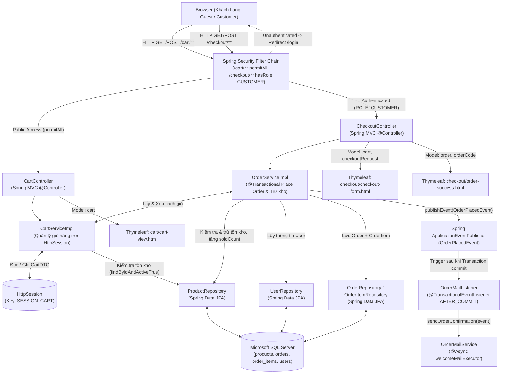
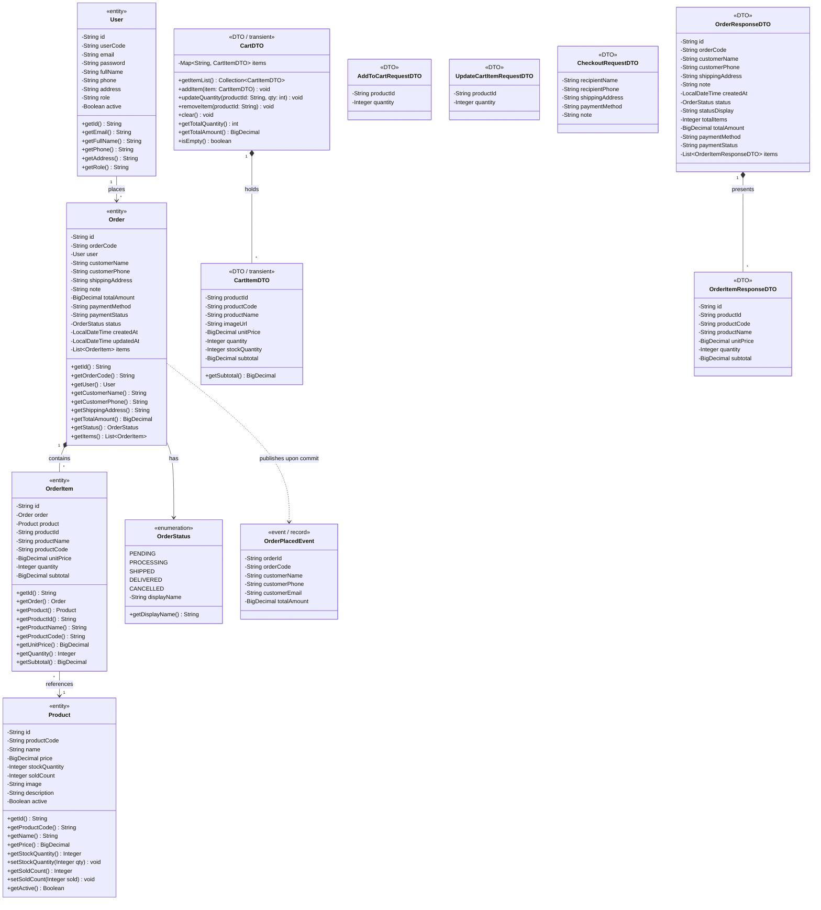

# Mermaid Diagrams: cart-checkout

Tài liệu thiết kế kiến trúc và sơ đồ tương tác chi tiết cho toàn bộ Module **Giỏ hàng & Thanh toán (Cart & Checkout)** (`uc002-shopping-cart` và `uc003-checkout`).

> [!NOTE]
> Tài liệu này tổng hợp kiến trúc phân tầng, sơ đồ tuần tự và sơ đồ lớp cho cả 2 chức năng cốt lõi của Module 3 (Dương):
> - **Giỏ hàng (`uc002-shopping-cart`):** Xem chi tiết tại [`docs/diagrams/shopping-cart.md`](file:///E:/java-www/www-programming/docs/diagrams/shopping-cart.md) & [`docs/diagrams/activity-shopping-cart.md`](file:///E:/java-www/www-programming/docs/diagrams/activity-shopping-cart.md).
> - **Thanh toán (`uc003-checkout`):** Xem chi tiết tại [`docs/diagrams/checkout.md`](file:///E:/java-www/www-programming/docs/diagrams/checkout.md) & [`docs/diagrams/activity-checkout.md`](file:///E:/java-www/www-programming/docs/diagrams/activity-checkout.md).

---

## 1. System Architecture

Biểu diễn luồng phân lớp Server-Side Rendering (SSR) tích hợp từ trình duyệt người dùng qua tầng bảo mật Spring Security (`/cart/**` cho phép truy cập công khai `permitAll`, `/checkout/**` bắt buộc xác thực `hasRole('CUSTOMER')`), Spring MVC Controllers (`CartController`, `CheckoutController`), Jakarta Bean Validation JSR-380, Service Layer (`CartServiceImpl`, `OrderServiceImpl`), Session Storage (`HttpSession` với key `SESSION_CART`), Spring Data JPA Repositories (`UserRepository`, `ProductRepository`, `OrderRepository`, `OrderItemRepository`) kết nối tới Microsoft SQL Server, đồng thời xử lý sự kiện phát email xác nhận bất đồng bộ `@Async` (`OrderPlacedEvent` $\rightarrow$ `OrderMailListener` $\rightarrow$ `OrderMailService` $\rightarrow$ SMTP Server).



---

## 2. Sequence Diagram (Integrated Academic Standard)

Mô tả chi tiết chu kỳ Request-Response cho nghiệp vụ cốt lõi **Đặt hàng & Thanh toán (Checkout)**, bao gồm kiểm tra quyền truy cập `ROLE_CUSTOMER`, kiểm tra giỏ hàng trên Session, validate dữ liệu JSR-380, kiểm tra tồn kho CSDL, trừ tồn kho và tăng `soldCount`, thực thi transaction lưu `Order` & `OrderItem`, làm sạch giỏ hàng trong `HttpSession` (`SESSION_CART`), và bắn sự kiện `OrderPlacedEvent` gửi email xác nhận bất đồng bộ `@Async` sau `TransactionPhase.AFTER_COMMIT`.

```mermaid
sequenceDiagram
    autonumber
    actor Customer as Khách hàng (Customer)
    participant Browser as Trình duyệt (Client)
    participant Security as Spring Security
    participant Controller as CheckoutController
    participant OrderSvc as OrderServiceImpl
    participant CartSvc as CartServiceImpl
    participant Session as HttpSession (SESSION_CART)
    participant ProductRepo as ProductRepository
    participant OrderRepo as OrderRepository
    participant DB as SQL Server
    participant EventPub as ApplicationEventPublisher
    participant MailListener as OrderMailListener
    participant MailSvc as OrderMailService
    participant View as Thymeleaf (order-success)

    Customer->>Browser: Nhấn nút "Xác Nhận Đặt Hàng" trên Form Checkout
    Browser->>Security: HTTP POST /checkout (recipientName, phone, address, paymentMethod, note)
    
    alt 2.1.1 Chưa đăng nhập hoặc không có vai trò ROLE_CUSTOMER (Exception Flow)
        Security-->>Browser: HTTP 302 Redirect to /login (SavedRequest: /checkout)
        Browser-->>Customer: Chuyển hướng tới trang Đăng nhập
    else Đã đăng nhập ROLE_CUSTOMER hợp lệ (Main Flow)
        Security->>Controller: processCheckout(checkoutRequest, bindingResult, principal, session, model, redirectAttrs)
        activate Controller

        Controller->>CartSvc: getCart(session)
        activate CartSvc
        CartSvc->>Session: getAttribute("SESSION_CART")
        activate Session
        Session-->>CartSvc: return CartDTO
        deactivate Session
        CartSvc-->>Controller: return CartDTO
        deactivate CartSvc

        alt 5.1.1 Giỏ hàng rỗng khi submit (Exception Flow)
            Controller-->>Browser: HTTP 302 Redirect to /cart (Flash: "Giỏ hàng của bạn đang trống!")
            Browser-->>Customer: Hiển thị lại giỏ hàng kèm cảnh báo
        else Giỏ hàng có sản phẩm hợp lệ
            Controller->>Controller: Validate CheckoutRequestDTO (JSR-380 @Valid)
            
            alt 5.2.1 Vi phạm quy tắc Validate Form JSR-380 (Exception Flow)
                Controller-->>Browser: Trả về view "checkout/checkout-form" (kèm lỗi BindingResult)
                Browser-->>Customer: Hiển thị lỗi đỏ dưới input field
            else Dữ liệu Form hợp lệ theo JSR-380
                Controller->>OrderSvc: placeOrder(session, userEmail, checkoutRequest)
                activate OrderSvc

                %% Loop kiểm tra tồn kho
                Note over OrderSvc, DB: Giao dịch @Transactional: Kiểm tra tồn kho & Trừ kho
                loop Duyệt từng CartItemDTO trong giỏ
                    OrderSvc->>ProductRepo: findByIdAndActiveTrue(item.productId)
                    activate ProductRepo
                    ProductRepo->>DB: SELECT * FROM products WHERE id = ? AND active = 1
                    activate DB
                    DB-->>ProductRepo: return Product
                    deactivate DB
                    ProductRepo-->>OrderSvc: return Product
                    deactivate ProductRepo
                end

                alt 6.1.1 & 6.2.1 Sản phẩm không khả dụng hoặc số lượng mua > Tồn kho
                    OrderSvc-->>Controller: throw IllegalArgumentException("Tồn kho không đủ...")
                    deactivate OrderSvc
                    Controller-->>Browser: Trả về view "checkout/checkout-form" (Flash error)
                    Browser-->>Customer: Hiển thị thông báo lỗi, Rollback Transaction
                else Tồn kho đáp ứng đầy đủ
                    loop Duyệt từng món hàng để cập nhật kho
                        OrderSvc->>OrderSvc: product.setStockQuantity(stock - qty)
                        OrderSvc->>OrderSvc: product.setSoldCount(sold + qty)
                        OrderSvc->>ProductRepo: save(product)
                        activate ProductRepo
                        ProductRepo->>DB: UPDATE products SET stock_quantity = ?, sold_count = ? WHERE id = ?
                        activate DB
                        DB-->>ProductRepo: return Updated Product
                        deactivate DB
                        ProductRepo-->>OrderSvc: Saved Product
                        deactivate ProductRepo
                        OrderSvc->>OrderSvc: Build OrderItem(productId, product, name, price, qty, subtotal)
                    end
                    
                    OrderSvc->>OrderSvc: generateUniqueOrderCode() -> "ORD26XXXXXX"
                    OrderSvc->>OrderSvc: Build Entity Order(status=PENDING, paymentStatus=UNPAID)
                    OrderSvc->>OrderRepo: save(order)
                    activate OrderRepo
                    OrderRepo->>DB: INSERT INTO orders ...; INSERT INTO order_items ...
                    activate DB
                    DB-->>OrderRepo: return Saved Order
                    deactivate DB
                    OrderRepo-->>OrderSvc: return Order
                    deactivate OrderRepo

                    OrderSvc->>CartSvc: clearCart(session)
                    activate CartSvc
                    CartSvc->>Session: setAttribute("SESSION_CART", emptyCart)
                    activate Session
                    Session-->>CartSvc: OK
                    deactivate Session
                    CartSvc-->>OrderSvc: void
                    deactivate CartSvc
                    
                    %% Bắn sự kiện gửi mail
                    OrderSvc->>EventPub: publishEvent(new OrderPlacedEvent(...))
                    activate EventPub
                    EventPub-->>OrderSvc: Dispatched
                    deactivate EventPub

                    OrderSvc->>OrderSvc: Map Saved Order sang OrderResponseDTO
                    OrderSvc-->>Controller: return OrderResponseDTO
                    deactivate OrderSvc

                    %% Listener gửi mail sau commit
                    Note over MailListener, MailSvc: Sau khi Commit CSDL: @TransactionalEventListener(phase = AFTER_COMMIT)
                    EventPub->>MailListener: onOrderPlaced(event)
                    activate MailListener
                    MailListener->>MailSvc: sendOrderConfirmation(event)
                    activate MailSvc
                    Note over MailSvc: Xử lý bất đồng bộ @Async("welcomeMailExecutor")
                    MailSvc->>DB: JavaMailSender.send(SimpleMailMessage)
                    deactivate MailSvc
                    deactivate MailListener

                    Controller-->>Browser: HTTP 302 Redirect to /checkout/success (PRG Pattern)
                    Browser->>Controller: HTTP GET /checkout/success
                    Controller->>View: Render "checkout/order-success"
                    activate View
                    View-->>Browser: HTML kết quả đơn hàng
                    deactivate View
                    Browser-->>Customer: Hiển thị mã đơn hàng, số tiền, cảm ơn quý khách!
                end
            end
        end
        deactivate Controller
    end
```

---

## 3. Class Diagram

Biểu diễn cấu trúc phân lớp giữa các Thực thể CSDL (`<<entity>>`), Lớp Liệt kê Trạng thái (`<<enumeration>>`), Đối tượng Chuyển giao Dữ liệu (`<<DTO>>`), Đối tượng Giỏ hàng Session (`<<transient>>`) và Bản ghi Sự kiện Nghiệp vụ (`<<event / record>>`).


