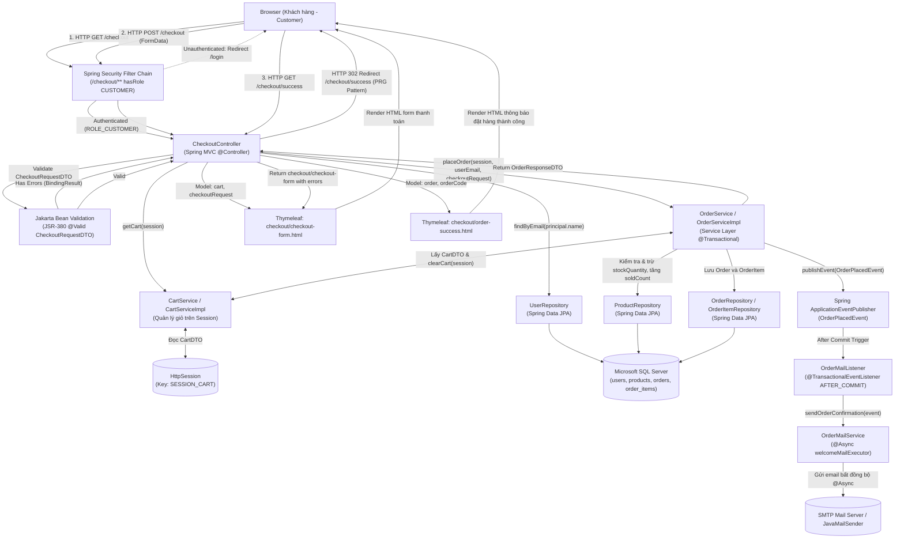
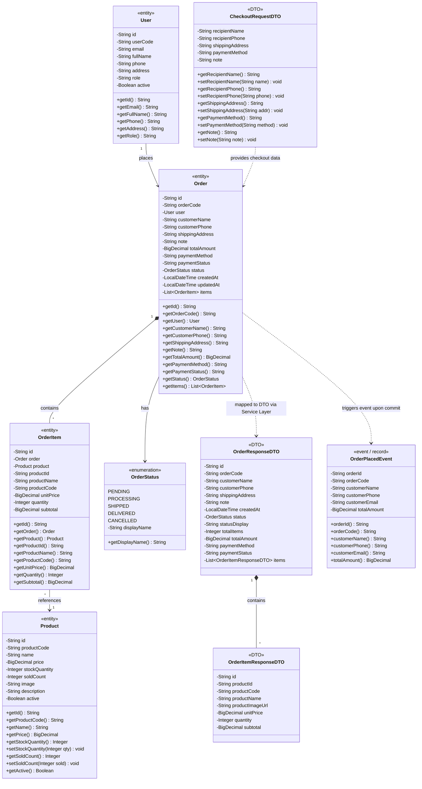

# Mermaid Diagrams: checkout

Tài liệu thiết kế kiến trúc và luồng xử lý chi tiết cho Use Case **Khách hàng thanh toán đơn hàng** (`uc003-checkout`).

---

## 1. System Architecture

Biểu diễn luồng phân lớp Server-Side Rendering (SSR) trong quy trình Đặt hàng & Thanh toán (Checkout): từ trình duyệt Khách hàng, qua bộ lọc Spring Security (`hasRole('CUSTOMER')` cho `/checkout/**`), Spring MVC `CheckoutController`, tầng kiểm tra tính hợp lệ Jakarta Bean Validation JSR-380, tầng nghiệp vụ `OrderServiceImpl` quản lý giao dịch `@Transactional(rollbackFor = Exception.class)`, tương tác với `CartService` để đọc và làm sạch `HttpSession` (`SESSION_CART`), truy xuất Spring Data JPA Repositories (`UserRepository`, `ProductRepository`, `OrderRepository`, `OrderItemRepository`) tới Microsoft SQL Server, đồng thời kích hoạt phát sự kiện `OrderPlacedEvent` gửi email xác nhận bất đồng bộ `@Async` qua `OrderMailListener` sau khi giao dịch commit thành công (`TransactionPhase.AFTER_COMMIT`).



---

## 2. Sequence Diagram

Mô tả chi tiết chu kỳ Request-Response cho nghiệp vụ **Đặt hàng & Thanh toán (Checkout)** bao quát toàn bộ quy trình: Mở form thanh toán, Xác thực quyền truy cập, Nạp thông tin khách hàng, Tiếp nhận submit form, Kiểm tra giỏ hàng, Xác thực JSR-380, Kiểm tra khả dụng và số lượng tồn kho từng sản phẩm, Trừ tồn kho & tăng số lượng đã bán, Sinh mã đơn hàng `orderCode`, Lưu thực thể `Order` và `OrderItem`, Xóa sạch giỏ hàng trong Session, Kích hoạt phát sự kiện và gửi email xác nhận đơn hàng bất đồng bộ sau commit, và Chuyển hướng PRG hiển thị màn hình hoàn tất.

```mermaid
sequenceDiagram
    autonumber
    actor Customer as Khách hàng (Customer)
    participant Browser as Trình duyệt (Client)
    participant Security as Spring Security
    participant Controller as CheckoutController
    participant CartSvc as CartServiceImpl
    participant OrderSvc as OrderServiceImpl
    participant Session as HttpSession (SESSION_CART)
    participant UserRepo as UserRepository
    participant ProdRepo as ProductRepository
    participant OrderRepo as OrderRepository
    participant DB as SQL Server
    participant EventPub as ApplicationEventPublisher
    participant MailListener as OrderMailListener
    participant MailSvc as OrderMailService
    participant View as Thymeleaf Engine

    %% Giai đoạn 1: Mở form thanh toán
    Note over Customer, View: Giai đoạn 1: Truy cập và hiển thị Form Thanh toán (GET /checkout)
    Customer->>Browser: Nhấn nút "Tiến Hành Đặt Hàng" (hoặc từ "Mua Ngay")
    Browser->>Security: HTTP GET /checkout
    
    alt 2.1.1 Chưa đăng nhập hoặc không có vai trò ROLE_CUSTOMER
        Security-->>Browser: HTTP 302 Redirect to /login (SavedRequest: /checkout)
        Browser-->>Customer: Chuyển hướng tới trang Đăng nhập
    else Đã đăng nhập ROLE_CUSTOMER hợp lệ
        Security->>Controller: showCheckoutForm(principal, session, model, redirectAttrs)
        activate Controller

        Controller->>CartSvc: getCart(session)
        activate CartSvc
        CartSvc->>Session: getAttribute("SESSION_CART")
        activate Session
        Session-->>CartSvc: return CartDTO
        deactivate Session
        CartSvc-->>Controller: return CartDTO
        deactivate CartSvc

        alt 2.2.1 Giỏ hàng trong Session đang trống
            Controller->>Controller: redirectAttributes.addFlashAttribute("errorMessage", "Giỏ hàng đang trống!...")
            Controller-->>Browser: HTTP 302 Redirect to /cart
            deactivate Controller
            Browser-->>Customer: Hiển thị lại giỏ hàng kèm cảnh báo giỏ trống
        else Giỏ hàng có sản phẩm hợp lệ
            Controller->>Controller: Khởi tạo new CheckoutRequestDTO()
            Controller->>UserRepo: findByEmail(principal.getName())
            activate UserRepo
            UserRepo->>DB: SELECT * FROM users WHERE email = ?
            activate DB
            DB-->>UserRepo: User entity
            deactivate DB
            UserRepo-->>Controller: Optional<User>
            deactivate UserRepo

            Controller->>Controller: Nạp fullName, phone, address vào checkoutRequest
            Controller->>Controller: model.addAttribute("cart", cart)
            Controller->>Controller: model.addAttribute("checkoutRequest", checkoutRequest)
            Controller->>View: render("checkout/checkout-form", model)
            deactivate Controller
            activate View
            View-->>Browser: Render HTML biểu mẫu thanh toán & tóm tắt đơn
            deactivate View
            Browser-->>Customer: Hiển thị form giao nhận kèm danh sách món hàng
        end
    end

    %% Giai đoạn 2: Submit đặt hàng hoặc Hủy bỏ
    Note over Customer, View: Giai đoạn 2: Gửi thông tin đặt hàng (POST /checkout)
    alt 4.1 Khách hàng nhấn "← Quay lại giỏ hàng"
        Customer->>Browser: Nhấn liên kết "Quay lại giỏ hàng"
        Browser->>Controller: HTTP GET /cart
        activate Controller
        Controller-->>Browser: HTTP 302 Redirect to /cart
        deactivate Controller
        Browser-->>Customer: Chuyển về màn hình giỏ hàng
    else Khách hàng điền form và nhấn "Xác Nhận Đặt Hàng"
        Customer->>Browser: Điền thông tin giao nhận & nhấn "Xác Nhận Đặt Hàng"
        Browser->>Security: HTTP POST /checkout (recipientName, phone, address, paymentMethod, note)
        Security->>Controller: processCheckout(checkoutRequest, bindingResult, principal, session, model, redirectAttrs)
        activate Controller

        Controller->>CartSvc: getCart(session)
        activate CartSvc
        CartSvc->>Session: getAttribute("SESSION_CART")
        activate Session
        Session-->>CartSvc: return CartDTO
        deactivate Session
        CartSvc-->>Controller: return CartDTO
        deactivate CartSvc

        alt 5.1.1 Giỏ hàng bị trống khi gửi submit
            Controller->>Controller: redirectAttributes.addFlashAttribute("errorMessage", "Giỏ hàng của bạn đang trống!")
            Controller-->>Browser: HTTP 302 Redirect to /cart
            Browser-->>Customer: Chuyển hướng về giỏ kèm cảnh báo lỗi
        else Giỏ hàng hợp lệ
            Controller->>Controller: Kiểm tra @Valid CheckoutRequestDTO (BindingResult)

            alt 5.2.1 Vi phạm ràng buộc Bean Validation JSR-380
                Controller->>Controller: model.addAttribute("cart", cart)
                Controller->>View: render("checkout/checkout-form", model)
                activate View
                View-->>Browser: Render form giữ lại dữ liệu + thông báo lỗi màu đỏ inline
                deactivate View
                Browser-->>Customer: Hiển thị lỗi trường dữ liệu để người dùng sửa đổi
            else Dữ liệu biểu mẫu hợp lệ theo JSR-380
                %% Bắt đầu Transaction
                Controller->>OrderSvc: placeOrder(session, userEmail, checkoutRequest)
                activate OrderSvc

                %% Loop kiểm tra tồn kho từng sản phẩm
                Note over OrderSvc, DB: Giao dịch @Transactional: Kiểm tra khả dụng & Tồn kho
                OrderSvc->>CartSvc: getCart(session)
                activate CartSvc
                CartSvc-->>OrderSvc: CartDTO cart
                deactivate CartSvc

                loop Duyệt từng CartItemDTO trong giỏ hàng
                    OrderSvc->>ProdRepo: findByIdAndActiveTrue(item.productId)
                    activate ProdRepo
                    ProdRepo->>DB: SELECT * FROM products WHERE id = ? AND active = 1
                    activate DB
                    DB-->>ProdRepo: Product entity
                    deactivate DB
                    ProdRepo-->>OrderSvc: Optional<Product>
                    deactivate ProdRepo
                end

                alt 6.1.1 Có sản phẩm bị ngừng kinh doanh hoặc xóa khỏi CSDL
                    OrderSvc-->>Controller: throw IllegalArgumentException("Sản phẩm không còn khả dụng!")
                    deactivate OrderSvc
                    Controller->>Controller: model.addAttribute("cart", cart); model.addAttribute("errorMessage", ...)
                    Controller->>View: render("checkout/checkout-form", model)
                    activate View
                    View-->>Browser: Render form kèm thông báo lỗi sản phẩm không khả dụng
                    deactivate View
                    Browser-->>Customer: Cảnh báo lỗi sản phẩm, Transaction Rollback
                else 6.2.1 Có sản phẩm không đủ số lượng tồn kho (item.quantity > product.stockQuantity)
                    OrderSvc-->>Controller: throw IllegalArgumentException("Sản phẩm không đủ số lượng trong kho...")
                    deactivate OrderSvc
                    Controller->>Controller: model.addAttribute("cart", cart); model.addAttribute("errorMessage", ...)
                    Controller->>View: render("checkout/checkout-form", model)
                    activate View
                    View-->>Browser: Render form kèm cảnh báo thiếu tồn kho
                    deactivate View
                    Browser-->>Customer: Cảnh báo lỗi tồn kho, Transaction Rollback
                else Tất cả sản phẩm hợp lệ và đủ tồn kho
                    %% Trừ kho và tăng soldCount
                    Note over OrderSvc, DB: Trừ stockQuantity, tăng soldCount và tạo Order & OrderItem
                    loop Duyệt từng món hàng hợp lệ
                        OrderSvc->>OrderSvc: product.setStockQuantity(stock - qty)
                        OrderSvc->>OrderSvc: product.setSoldCount(sold + qty)
                        OrderSvc->>ProdRepo: save(product)
                        activate ProdRepo
                        ProdRepo->>DB: UPDATE products SET stock_quantity = ?, sold_count = ? WHERE id = ?
                        activate DB
                        DB-->>ProdRepo: Updated
                        deactivate DB
                        ProdRepo-->>OrderSvc: Saved Product
                        deactivate ProdRepo
                        OrderSvc->>OrderSvc: Build OrderItem(productId, product, name, price, qty, subtotal)
                    end

                    %% Sinh mã đơn hàng và lưu Order
                    OrderSvc->>OrderSvc: generateUniqueOrderCode() -> "ORD26XXXXXX"
                    OrderSvc->>OrderRepo: existsByOrderCode(orderCode)
                    activate OrderRepo
                    OrderRepo->>DB: SELECT COUNT(1) FROM orders WHERE order_code = ?
                    activate DB
                    DB-->>OrderRepo: count = 0
                    deactivate DB
                    OrderRepo-->>OrderSvc: false (Mã hợp lệ duy nhất)
                    deactivate OrderRepo

                    OrderSvc->>OrderSvc: Build Order(orderCode, user, recipient, amount, PENDING, UNPAID, items)
                    OrderSvc->>OrderRepo: save(order)
                    activate OrderRepo
                    OrderRepo->>DB: INSERT INTO orders (...); INSERT INTO order_items (...)
                    activate DB

                    alt 8.1.1 Lỗi kết nối CSDL hoặc lỗi vi phạm ràng buộc
                        DB-->>OrderRepo: DataAccessException / DB Error
                        deactivate DB
                        OrderRepo-->>OrderSvc: throw Exception (Rollback Transaction)
                        deactivate OrderRepo
                        OrderSvc-->>Controller: throw Exception
                        deactivate OrderSvc
                        Controller->>Controller: model.addAttribute("errorMessage", "Không thể hoàn tất đơn hàng...")
                        Controller->>View: render("checkout/checkout-form", model)
                        activate View
                        View-->>Browser: Render thông báo lỗi hệ thống
                        deactivate View
                        Browser-->>Customer: Hiển thị thông báo sự cố hệ thống
                    else Lưu CSDL thành công
                        activate DB
                        DB-->>OrderRepo: Persisted Order & Items
                        deactivate DB
                        OrderRepo-->>OrderSvc: Saved Order entity
                        deactivate OrderRepo

                        %% Xóa giỏ hàng Session
                        OrderSvc->>CartSvc: clearCart(session)
                        activate CartSvc
                        CartSvc->>Session: setAttribute("SESSION_CART", emptyCart)
                        activate Session
                        Session-->>CartSvc: OK
                        deactivate Session
                        CartSvc-->>OrderSvc: void
                        deactivate CartSvc

                        %% Phát sự kiện gửi mail
                        OrderSvc->>EventPub: publishEvent(new OrderPlacedEvent(orderId, orderCode, customerName, phone, email, totalAmount))
                        activate EventPub
                        EventPub-->>OrderSvc: Event dispatched
                        deactivate EventPub

                        OrderSvc->>OrderSvc: Map Order sang OrderResponseDTO
                        OrderSvc-->>Controller: return OrderResponseDTO
                        deactivate OrderSvc

                        %% Kích hoạt gửi Mail Async sau Commit
                        Note over MailListener, MailSvc: Sau khi Commit CSDL: @TransactionalEventListener(phase = AFTER_COMMIT)
                        EventPub->>MailListener: onOrderPlaced(event)
                        activate MailListener
                        MailListener->>MailSvc: sendOrderConfirmation(event)
                        activate MailSvc
                        Note over MailSvc: Xử lý bất đồng bộ @Async("welcomeMailExecutor")
                        alt 10.1.1 Hàng đợi mail đầy hoặc lỗi kết nối SMTP
                            MailSvc->>MailSvc: log.warn("Order mail queue full or SMTP error...")
                        else Gửi mail thành công
                            MailSvc->>DB: JavaMailSender.send(SimpleMailMessage)
                            MailSvc->>MailSvc: log.info("Order confirmation mail sent successfully")
                        end
                        deactivate MailSvc
                        deactivate MailListener

                        %% PRG Pattern sang /checkout/success
                        Controller->>Controller: redirectAttributes.addFlashAttribute("orderCode", placedOrder.getOrderCode())
                        Controller->>Controller: redirectAttributes.addFlashAttribute("order", placedOrder)
                        Controller->>Controller: redirectAttributes.addFlashAttribute("successMessage", "Đặt hàng thành công!")
                        Controller-->>Browser: HTTP 302 Redirect to /checkout/success (PRG Pattern)

                        Browser->>Controller: HTTP GET /checkout/success
                        Controller->>View: render("checkout/order-success", model)
                        activate View
                        View-->>Browser: Render HTML màn hình đặt hàng thành công
                        deactivate View
                        Browser-->>Customer: Hiển thị mã đơn hàng ORD26XXXXXX, thông tin giao nhận và tổng tiền
                    end
                end
            end
        end
        deactivate Controller
    end
```

---

## 3. Class Diagram

Mô hình cấu trúc lớp chi tiết giữa các Thực thể CSDL (`<<entity>>`), Lớp Liệt kê Trạng thái (`<<enumeration>>`), Đối tượng Truyền dữ liệu (`<<DTO>>`) và Bản ghi Sự kiện Nghiệp vụ (`<<event / record>>`) tham gia trong use case `checkout`.


