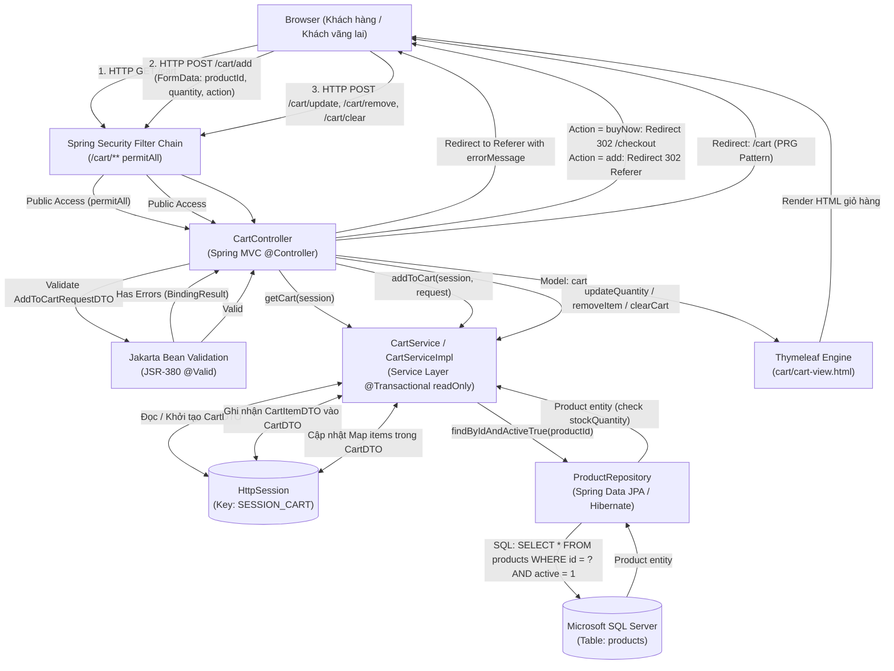
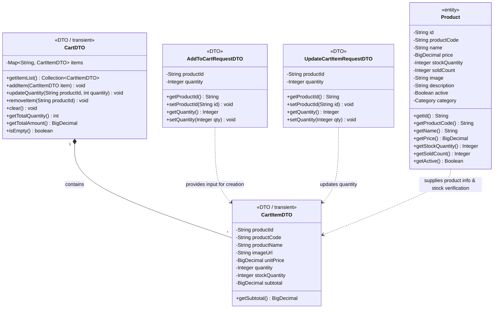

# Mermaid Diagrams: shopping-cart

Tài liệu thiết kế kiến trúc và luồng xử lý chi tiết cho Use Case **Khách hàng quản lý giỏ hàng** (`uc002-shopping-cart`).

---

## 1. System Architecture

Biểu diễn luồng phân lớp Server-Side Rendering (SSR) trong quy trình quản lý giỏ hàng: từ trình duyệt người dùng (Khách hàng hoặc Khách vãng lai), qua bộ lọc Spring Security (`permitAll` đối với `/cart/**`), Spring MVC `CartController`, tầng kiểm tra tính hợp lệ Jakarta Bean Validation, tầng nghiệp vụ `CartServiceImpl`, bộ nhớ phiên làm việc `HttpSession` (`SESSION_CART`), tầng truy cập dữ liệu Spring Data JPA `ProductRepository`, tới hệ quản trị cơ sở dữ liệu Microsoft SQL Server và kết xuất giao diện qua Thymeleaf Engine.



---

## 2. Sequence Diagram

Mô tả chi tiết chu kỳ Request-Response cho toàn bộ các thao tác giỏ hàng: Thêm vào giỏ từ trang sản phẩm (rẽ nhánh "Thêm vào giỏ" vs "Mua ngay"), Hiển thị giỏ hàng, Cập nhật số lượng, Xóa từng món và Xóa toàn bộ giỏ hàng; bao quát toàn bộ Main Flow, Alternate Flows và các Exception Flows.

```mermaid
sequenceDiagram
    autonumber
    actor Customer as Khách hàng (Customer / Guest)
    participant Browser as Trình duyệt (Client)
    participant Security as Spring Security
    participant Controller as CartController
    participant Service as CartServiceImpl
    participant Session as HttpSession (SESSION_CART)
    participant Repo as ProductRepository
    participant DB as SQL Server (products)
    participant View as Thymeleaf (cart/cart-view)

    %% Giai đoạn 1: Thêm sản phẩm vào giỏ hàng
    Note over Customer, View: Giai đoạn 1: Thêm sản phẩm vào giỏ hàng (POST /cart/add)
    Customer->>Browser: Chọn số lượng và nhấn "Thêm Vào Giỏ" hoặc "Mua Ngay"
    Browser->>Security: HTTP POST /cart/add (productId, quantity, action, Referer)
    Security->>Controller: addToCart(request, bindingResult, action, redirect, servletRequest, session, redirectAttrs)
    activate Controller

    %% Kiểm tra Validation JSR-380
    alt 2.1.1 Dữ liệu không hợp lệ theo JSR-380 (productId rỗng hoặc quantity < 1)
        Controller->>Controller: bindingResult.hasErrors() = true
        Controller->>Controller: redirectAttributes.addFlashAttribute("errorMessage", "Số lượng mua phải từ 1 trở lên")
        Controller-->>Browser: HTTP 302 Redirect to Referer (trang trước)
        Browser-->>Customer: Hiển thị cảnh báo lỗi nhập liệu màu đỏ
    else Dữ liệu hợp lệ theo JSR-380
        Controller->>Service: addToCart(session, request)
        activate Service

        Service->>Repo: findByIdAndActiveTrue(productId)
        activate Repo
        Repo->>DB: SELECT * FROM products WHERE id = ? AND active = 1
        activate DB
        DB-->>Repo: ResultSet (Product data)
        deactivate DB
        Repo-->>Service: Optional<Product>
        deactivate Repo

        alt 3.1.1 Sản phẩm không tồn tại hoặc đã ngừng kinh doanh (active = false)
            Service-->>Controller: throw IllegalArgumentException("Sản phẩm không tồn tại hoặc đã ngừng kinh doanh!")
            deactivate Service
            Controller->>Controller: redirectAttributes.addFlashAttribute("errorMessage", ...)
            Controller-->>Browser: HTTP 302 Redirect to Referer
            Browser-->>Customer: Hiển thị cảnh báo sản phẩm không hợp lệ
        else Sản phẩm tồn tại và đang mở bán
            Service->>Service: getCart(session)
            Service->>Session: getAttribute("SESSION_CART")
            activate Session
            Session-->>Service: CartDTO cart
            deactivate Session

            Service->>Service: Tính totalRequestedQuantity = currentQuantityInCart + request.quantity

            alt 4.1.1 Số lượng yêu cầu vượt quá tồn kho khả dụng
                Service-->>Controller: throw IllegalArgumentException("Số lượng yêu cầu vượt quá tồn kho...")
                deactivate Service
                Controller->>Controller: redirectAttributes.addFlashAttribute("errorMessage", ...)
                Controller-->>Browser: HTTP 302 Redirect to Referer
                Browser-->>Customer: Hiển thị thông báo kho không đủ hàng
            else Tồn kho đáp ứng đủ số lượng
                Service->>Service: Build CartItemDTO (productId, code, name, price, stock, quantity)
                Service->>Service: cart.addItem(item)
                Service->>Session: setAttribute("SESSION_CART", cart)
                activate Session
                Session-->>Service: OK
                deactivate Session
                Service-->>Controller: void (Hoàn thành thêm vào giỏ)
                deactivate Service

                alt 1.1 Khách hàng chọn "Mua Ngay" (action=buyNow hoặc redirect=checkout)
                    Controller-->>Browser: HTTP 302 Redirect to /checkout (Chuyển thẳng sang thanh toán)
                    Browser-->>Customer: Hiển thị màn hình đặt hàng & thanh toán
                else Khách hàng chọn "Thêm Vào Giỏ" (action=add)
                    Controller->>Controller: redirectAttributes.addFlashAttribute("successMessage", "Đã thêm sản phẩm vào giỏ hàng thành công!")
                    Controller-->>Browser: HTTP 302 Redirect to Referer (hoặc /cart)
                    Browser-->>Customer: Hiển thị alert xanh "Đã thêm sản phẩm vào giỏ hàng thành công!"
                end
            end
        end
    end
    deactivate Controller

    %% Giai đoạn 2: Xem giỏ hàng
    Note over Customer, View: Giai đoạn 2: Truy cập và hiển thị trang Giỏ hàng (GET /cart)
    Customer->>Browser: Nhấn vào biểu tượng Giỏ hàng trên thanh điều hướng
    Browser->>Security: HTTP GET /cart
    Security->>Controller: viewCart(session, model)
    activate Controller
    Controller->>Service: getCart(session)
    activate Service
    Service->>Session: getAttribute("SESSION_CART")
    activate Session
    Session-->>Service: return CartDTO (hoặc khởi tạo mới nếu null)
    deactivate Session
    Service-->>Controller: return CartDTO
    deactivate Service

    Controller->>Controller: model.addAttribute("cart", cart)
    Controller->>View: render("cart/cart-view", model)
    activate View
    alt 2.1 Giỏ hàng rỗng (cart.isEmpty() == true)
        View-->>Browser: Render giao diện empty-state-box kèm nút "Khám phá sản phẩm ngay"
        Browser-->>Customer: Hiển thị giỏ hàng trống
    else Giỏ hàng có sản phẩm
        View-->>Browser: Render bảng sản phẩm, hình ảnh, đơn giá, tổng tiền, nút Thanh toán
        Browser-->>Customer: Hiển thị chi tiết giỏ hàng đầy đủ
    end
    deactivate View
    deactivate Controller

    %% Giai đoạn 3: Cập nhật số lượng mặt hàng
    Note over Customer, View: Giai đoạn 3: Cập nhật số lượng sản phẩm (POST /cart/update)
    Customer->>Browser: Thay đổi số lượng tại ô input và nhấn nút "Lưu"
    Browser->>Security: HTTP POST /cart/update (productId, quantity)
    Security->>Controller: updateQuantity(updateRequest, bindingResult, session, redirectAttrs)
    activate Controller

    alt 4.1.1 Dữ liệu cập nhật không hợp lệ (quantity < 1)
        Controller->>Controller: redirectAttributes.addFlashAttribute("errorMessage", "Số lượng không hợp lệ!")
        Controller-->>Browser: HTTP 302 Redirect to /cart
        Browser-->>Customer: Giữ nguyên số lượng cũ kèm thông báo lỗi
    else Dữ liệu form hợp lệ JSR-380
        Controller->>Service: updateQuantity(session, updateRequest)
        activate Service
        Service->>Service: getCart(session)
        Service->>Session: getAttribute("SESSION_CART")
        activate Session
        Session-->>Service: CartDTO cart
        deactivate Session

        alt 5.1.1 Sản phẩm không có trong giỏ hàng
            Service-->>Controller: throw IllegalArgumentException("Sản phẩm không có trong giỏ hàng!")
            deactivate Service
            Controller->>Controller: redirectAttributes.addFlashAttribute("errorMessage", ...)
            Controller-->>Browser: HTTP 302 Redirect to /cart
            Browser-->>Customer: Hiển thị cảnh báo không tìm thấy món hàng
        else Sản phẩm có trong giỏ
            Service->>Repo: findByIdAndActiveTrue(productId)
            activate Repo
            Repo->>DB: SELECT * FROM products WHERE id = ? AND active = 1
            activate DB
            DB-->>Repo: Product data
            deactivate DB
            Repo-->>Service: Optional<Product>
            deactivate Repo

            alt 5.2.1 Số lượng cập nhật vượt quá tồn kho khả dụng
                Service-->>Controller: throw IllegalArgumentException("Số lượng cập nhật vượt quá tồn kho...")
                deactivate Service
                Controller->>Controller: redirectAttributes.addFlashAttribute("errorMessage", ...)
                Controller-->>Browser: HTTP 302 Redirect to /cart
                Browser-->>Customer: Giữ nguyên số lượng cũ kèm cảnh báo vượt tồn kho
            else Tồn kho đáp ứng số lượng mới
                Service->>Service: cart.updateQuantity(productId, quantity)
                Service->>Session: setAttribute("SESSION_CART", cart)
                activate Session
                Session-->>Service: OK
                deactivate Session
                Service-->>Controller: void
                deactivate Service
                Controller->>Controller: redirectAttributes.addFlashAttribute("successMessage", "Đã cập nhật số lượng thành công!")
                Controller-->>Browser: HTTP 302 Redirect to /cart (PRG Pattern)
                Browser-->>Customer: Hiển thị số lượng và tổng tiền mới cập nhật
            end
        end
    end
    deactivate Controller

    %% Giai đoạn 4: Xóa từng món và Xóa toàn bộ giỏ
    Note over Customer, View: Giai đoạn 4: Xóa món hàng (POST /cart/remove) hoặc Xóa tất cả (POST /cart/clear)
    alt 3.1 Khách hàng xóa một món hàng khỏi giỏ
        Customer->>Browser: Nhấn nút thùng rác "Xóa"
        Browser->>Security: HTTP POST /cart/remove (productId)
        Security->>Controller: removeItem(productId, session, redirectAttrs)
        activate Controller
        Controller->>Service: removeItem(session, productId)
        activate Service
        Service->>Service: cart.removeItem(productId)
        Service->>Session: setAttribute("SESSION_CART", cart)
        activate Session
        Session-->>Service: OK
        deactivate Session
        Service-->>Controller: void
        deactivate Service
        Controller->>Controller: redirectAttributes.addFlashAttribute("successMessage", "Đã xóa sản phẩm khỏi giỏ hàng!")
        Controller-->>Browser: HTTP 302 Redirect to /cart
        deactivate Controller
        Browser-->>Customer: Bảng giỏ hàng loại bỏ món hàng vừa xóa
    else 3.3 Khách hàng xóa toàn bộ giỏ hàng
        Customer->>Browser: Nhấn nút "Xóa tất cả"
        Browser->>Security: HTTP POST /cart/clear
        Security->>Controller: clearCart(session, redirectAttrs)
        activate Controller
        Controller->>Service: clearCart(session)
        activate Service
        Service->>Service: cart.clear()
        Service->>Session: setAttribute("SESSION_CART", cart)
        activate Session
        Session-->>Service: OK
        deactivate Session
        Service-->>Controller: void
        deactivate Service
        Controller->>Controller: redirectAttributes.addFlashAttribute("successMessage", "Đã làm trống giỏ hàng!")
        Controller-->>Browser: HTTP 302 Redirect to /cart
        deactivate Controller
        Browser-->>Customer: Hiển thị giao diện giỏ hàng trống (empty-state)
    end
```

---

## 3. Class Diagram

Mô hình cấu trúc lớp chi tiết giữa các Đối tượng Truyền dữ liệu Giỏ hàng (`<<DTO>>` / `<<transient>>`), Request DTOs và Thực thể `Product` (`<<entity>>`) tham gia trong use case `shopping-cart`.


