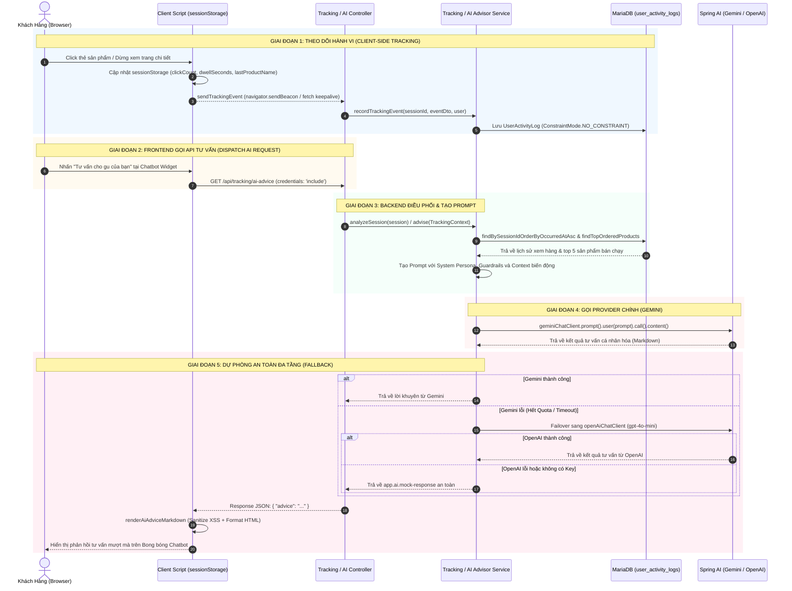

# TÀI LIỆU KỸ THUẬT CHUYÊN SÂU: KIẾN TRÚC AI & LUỒNG XỬ LÝ CHỨC NĂNG TRONG PINKYCLOUD

> **Tác giả:** Technical Lead & Software Architect  
> **Dự án:** PinkyCloud Cosmetics E-Commerce Platform  
> **Công nghệ lõi:** Java 17, Spring Boot 3.x, Spring AI 2.0.2 (Google GenAI & OpenAI Starters), MariaDB, Thymeleaf, HTML5/CSS3/Vanilla JS  
> **Tài liệu tham chiếu:** [`AiAdvisorService.java`](file:///src/main/java/iuh/wwwprogramming/service/AiAdvisorService.java), [`PinkyAiService.java`](file:///src/main/java/iuh/wwwprogramming/service/PinkyAiService.java), [`AiChatClientConfig.java`](file:///src/main/java/iuh/wwwprogramming/config/AiChatClientConfig.java), [`TrackingAiController.java`](file:///src/main/java/iuh/wwwprogramming/controller/api/TrackingAiController.java), [`PinkyAiController.java`](file:///src/main/java/iuh/wwwprogramming/controller/PinkyAiController.java), [`TrackingRestController.java`](file:///src/main/java/iuh/wwwprogramming/controller/api/TrackingRestController.java), [`TrackingServiceImpl.java`](file:///src/main/java/iuh/wwwprogramming/service/impl/TrackingServiceImpl.java), [`UserActivityLog.java`](file:///src/main/java/iuh/wwwprogramming/entity/UserActivityLog.java), [`customer-layout.html`](file:///src/main/resources/templates/layout/customer-layout.html), [`home.html`](file:///src/main/resources/templates/customer/home.html), [`product-detail.html`](file:///src/main/resources/templates/customer/product-detail.html).

---

## MỤC LỤC
1. [Tổng Quan Kiến Trúc AI Trong Hệ Thống PinkyCloud](#1-tổng-quan-kiến-trúc-ai-trong-hệ-thống-pinkycloud)
   - 1.1 Sơ đồ kiến trúc tổng thể (High-Level Architecture)
   - 1.2 Sơ đồ luồng xử lý chức năng 5 bước (5-Stage Functional Flow)
2. [Giai Đoạn 1: Theo Dõi Hành Vi Khách Hàng (Client-Side Tracking)](#2-giai-đoạn-1-theo-dõi-hành-vi-khách-hàng-client-side-tracking)
   - 2.1 Quản lý trạng thái bằng `sessionStorage` (`pinky_ui_tracking_session`)
   - 2.2 Cơ chế bắt sự kiện Click sản phẩm & Tính Dwell Time
   - 2.3 Cơ chế truyền tải Telemetry: `navigator.sendBeacon` & Fetch Keepalive
   - 2.4 Tiếp nhận Payload & Lưu vết tại Backend (`TrackingRestController` & `TrackingServiceImpl`)
   - 2.5 Thiết kế Thực thể `UserActivityLog` & Kỹ thuật `ConstraintMode.NO_CONSTRAINT`
3. [Giai Đoạn 2: Frontend Gọi API Tư Vấn (Dispatch AI Request)](#3-giai-đoạn-2-frontend-gọi-api-tư-vấn-dispatch-ai-request)
   - 3.1 Giao diện Chatbot & Điểm kích hoạt "Tư vấn cho gu của bạn"
   - 3.2 Tầm quan trọng của `credentials: 'include'` đối với phiên làm việc
   - 3.3 Cơ chế gọi 2 tầng: Context-Rich Pipeline vs. Param-Based Quick Pipeline
   - 3.4 Phân tích cú pháp Markdown sang HTML an toàn (`renderAiAdviceMarkdown`)
4. [Giai Đoạn 3: Backend Điều Phối & Kỹ Thuật Tạo Prompt (Prompt Engineering)](#4-giai-đoạn-3-backend-điều-phối--kỹ-thuật-tạo-prompt-prompt-engineering)
   - 4.1 Tiếp nhận Request, Phục hồi Ngữ cảnh phiên & Khởi tạo `TrackingContext`
   - 4.2 Làm giàu dữ liệu nghiệp vụ (Data Grounding từ `OrderItemRepository`)
   - 4.3 Kỹ thuật xây dựng Prompt: System Persona & Safety Guardrails
5. [Giai Đoạn 4: Tích Hợp Spring AI & Gọi Provider Chính (Gemini)](#5-giai-đoạn-4-tích-hợp-spring-ai--gọi-provider-chính-gemini)
   - 5.1 Khởi tạo `ChatClient` qua Dependency Injection với `@Qualifier` & `Optional`
   - 5.2 Phân tích cú pháp Fluent API thực thi: `client.get().prompt().user(...).call().content()`
   - 5.3 Cơ chế Serialization / Deserialization tự động giữa Spring AI và Google GenAI
   - 5.4 Cấu hình Model (`gemini-3.5-flash` / `gemini-3.8-flash`) & Bảo mật API Key qua Biến môi trường
6. [Giai Đoạn 5: Cơ Chế Dự Phòng An Toàn Đa Tầng (Multi-Provider Fallback & Resilience)](#6-giai-đoạn-5-cơ-chế-dự-phòng-an-toàn-đa-tầng-multi-provider-fallback--resilience)
   - 6.1 Logic chuyển mạch 3 cấp (Failover Pipeline: Gemini -> OpenAI -> Mock)
   - 6.2 Cơ chế Fallback cấp giao diện (Client-Side Graceful Degradation)
   - 6.3 Tầm quan trọng sống còn của Kiến trúc Chịu lỗi trong Môi trường Production
7. [Bảng So Sánh Hai Pipeline AI Trong Hệ Thống](#7-bảng-so-sánh-hai-pipeline-ai-trong-hệ-thống)
8. [Tổng Kết & Đánh Giá Kiến Trúc](#8-tổng-kết--đánh-giá-kiến-trúc)

---

## 1. TỔNG QUAN KIẾN TRÚC AI TRONG HỆ THỐNG PINKYCLOUD

PinkyCloud là nền tảng thương mại điện tử chuyên về mỹ phẩm trực tuyến. Khác với các hệ thống chatbot độc lập bên ngoài, Chatbot AI trong PinkyCloud được thiết kế như một **Trợ lý tư vấn mua sắm theo thời gian thực (Real-time Shopping Assistant)**, thấu hiểu trực tiếp từng hành động của khách truy cập ngay trong phiên lướt web hiện tại (lượt click thẻ sản phẩm, thời gian dừng xem trang chi tiết - dwell time, sản phẩm quan tâm gần nhất, lịch sử thêm giỏ hàng) và kết hợp với dữ liệu bán chạy thực tế của hệ thống để đưa ra khuyến nghị chuẩn xác.

Toàn bộ hệ thống tuân thủ 2 nguyên tắc kiến trúc cốt lõi:
1. **Zero User-Interruption (Non-blocking):** Mọi tác vụ ghi nhận hành vi tracking phải chạy ngầm, hoàn toàn không làm chậm tốc độ cuộn, click, hay chuyển hướng trang của người dùng.
2. **High Availability & Graceful Degradation (Khả năng chịu lỗi tuyệt đối):** Hệ thống tích hợp đa mô hình ngôn ngữ lớn (Multi-LLM Provider). Trong bất kỳ tình huống nào (hết hạn mức API, sự cố mạng, nhà cung cấp AI ngắt dịch vụ), khách hàng vẫn luôn nhận được câu trả lời tư vấn chất lượng từ hệ thống mà không bao giờ gặp lỗi giao diện trắng hay ứng dụng bị treo.

### 1.1 Sơ đồ kiến trúc tổng thể (High-Level Architecture)

```
+-------------------------------------------------------------------------------------------------------------+
|                                              CLIENT LAYER (BROWSER)                                         |
|                                                                                                             |
|  [ customer-layout.html ]                 [ product-detail.html ]                   [ home.html ]           |
|  +-----------------------+                +-----------------------+                 +--------------------+  |
|  | Event: PRODUCT_CLICK  |                | Event: DWELL_TIME     |                 | Chatbot UI Widget  |  |
|  | Storage:sessionStorage|                | Heartbeat: 5s,15s,30s |                 | "Tư vấn cho gu"    |  |
|  +-----------+-----------+                +-----------+-----------+                 +---------+----------+  |
+--------------|----------------------------------------|---------------------------------------|-------------+
               | navigator.sendBeacon                   | keepalive fetch                       | fetch (GET)
               | POST /api/tracking/event               | POST /api/tracking/event              | credentials:include
               v                                        v                                       v
+-------------------------------------------------------------------------------------------------------------+
|                                            SPRING BOOT CONTROLLER LAYER                                     |
|                                                                                                             |
|  [ TrackingRestController ]                   [ PinkyAiController ]                 [ TrackingAiController ]|
|  - Endpoint: POST /api/tracking/event         - Endpoint:                           - Endpoint:             |
|  - Nhận beacon/json telemetry                  GET /api/tracking/ai-advice           GET /api/tracking/      |
|  - Trích xuất Session ID                       (Primary Context-Rich)                 ai-advice-quick       |
|                                                                                     (Param Fallback)        |
+-------------------+-----------------------------------+---------------------------------------+-------------+
                    |                                   |                                       |
                    v                                   v                                       v
+-------------------------------------------------------------------------------------------------------------+
|                                                SERVICE LAYER                                                |
|                                                                                                             |
|  [ TrackingServiceImpl ]                      [ PinkyAiService ]                     [ AiAdvisorService ]   |
|  - Phân giải sessionId                        - Lấy log hành vi phiên                - Tiếp nhận            |
|  - Xử lý dwell/clicks                         - Lấy Top 5 bán chạy                     TrackingContext      |
|  - Ghi UserActivityLog                        - Ghép PromptTemplate                  - Failover Pipeline    |
+-------------------+-----------------------------------+---------------------------------------+-------------+
                    |                                   |                                       |
                    v                                   |                                       |
+------------------------------------+                  |                                       |
|          PERSISTENCE LAYER         |                  |                                       |
|                                    |                  |                                       |
|  [ UserActivityLogRepository ]     |                  |                                       |
|  - findBySessionIdOrderBy...       |                  |                                       |
|  - sumClickCountBetween...         |                  |                                       |
|                                    |                  |                                       |
|  [ OrderItemRepository ]           |                  |                                       |
|  - findTopOrderedProducts          |                  |                                       |
|                                    |                  |                                       |
|  Database: MariaDB                 |                  |                                       |
|  Table: user_activity_logs         |                  |                                       |
+------------------------------------+                  |                                       |
                                                        v                                       v
+-------------------------------------------------------------------------------------------------------------+
|                                         SPRING AI MULTI-PROVIDER LAYER                                      |
|                                                                                                             |
|                +--------------------------------------------------------------------+                       |
|                |              AiChatClientConfig (Conditional Beans)                |                       |
|                +---------------------------------+----------------------------------+                       |
|                                                  |                                                          |
|                         [ Cấp 1: Provider Chính ] v                                                         |
|                         Google GenAI ChatClient (@Qualifier("geminiChatClient"))                            |
|                         Model: gemini-3.5-flash / gemini-3.8-flash                                          |
|                                                  |                                                          |
|                                                  | (Bắt Exception / Quota / Timeout)                        |
|                                                  v                                                          |
|                         [ Cấp 2: Provider Dự phòng ]                                                        |
|                         OpenAI ChatClient (@Qualifier("openAiChatClient"))                                  |
|                         Model: gpt-4o-mini                                                                  |
|                                                  |                                                          |
|                                                  | (Nếu không có Key hoặc lỗi mạng)                         |
|                                                  v                                                          |
|                         [ Cấp 3: Mock Fallback An toàn ]                                                    |
|                         Static Business Response (app.ai.mock-response)                                     |
+-------------------------------------------------------------------------------------------------------------+
```

### 1.2 Sơ đồ luồng xử lý chức năng 5 bước (5-Stage Functional Flow)



---

## 2. GIAI ĐOẠN 1: THEO DÕI HÀNH VI KHÁCH HÀNG (CLIENT-SIDE TRACKING)

Tầng theo dõi hành vi đóng vai trò là "mắt xích thu thập dữ liệu thô" (Telemetry Ingestion). Dữ liệu này quyết định độ chính xác và tính cá nhân hóa của các câu trả lời do AI sinh ra ở các bước tiếp theo.

### 2.1 Quản lý trạng thái bằng `sessionStorage` (`pinky_ui_tracking_session`)

Hệ thống sử dụng cơ chế lưu trữ cục bộ phía trình duyệt (`sessionStorage`) để đồng bộ trạng thái ngay lập tức giữa các tương tác người dùng mà không cần chờ đợi phản hồi từ mạng.

#### Đoạn Code Trích Dẫn Thực Tế: [`customer-layout.html`](file:///src/main/resources/templates/layout/customer-layout.html#L237-L267)

```javascript
237:     // 5. UI Tracking System (Product Card Clicks & Product Detail Dwell Time)
238:     (function initPinkyUiTracking() {
239:         const TRACKING_STORAGE_KEY = 'pinky_ui_tracking_session';
240:         const TRACKING_ENDPOINT = '/api/tracking/event';
241: 
242:         function getSessionTrackingData() {
243:             try {
244:                 const raw = sessionStorage.getItem(TRACKING_STORAGE_KEY);
245:                 if (raw) {
246:                     return JSON.parse(raw);
247:                 }
248:             } catch (e) {
249:                 console.warn('Không thể đọc sessionStorage tracking:', e);
250:             }
251:             return {
252:                 clickCount: 0,
253:                 totalDwellSeconds: 0,
254:                 viewedProducts: [],
255:                 lastProductName: '',
256:                 lastProductId: ''
257:             };
258:         }
259: 
260:         function saveSessionTrackingData(data) {
261:             try {
262:                 sessionStorage.setItem(TRACKING_STORAGE_KEY, JSON.stringify(data));
263:                 window.dispatchEvent(new CustomEvent('pinky:tracking-updated', { detail: data }));
264:             } catch (e) {
265:                 console.warn('Không thể lưu sessionStorage tracking:', e);
266:             }
267:         }
```

#### Nhiệm vụ từng dòng code:
- **Dòng 238-240:** Tạo IIFE (Immediately Invoked Function Expression) đóng gói toàn bộ logic tracking, tránh làm ô nhiễm không gian biến toàn cục (`window`), khai báo hằng số định danh lưu trữ `pinky_ui_tracking_session` và endpoint `/api/tracking/event`.
- **Dòng 242-258:** Hàm `getSessionTrackingData` đọc chuỗi JSON từ `sessionStorage`. Nếu có dữ liệu, thực hiện parse và trả về đối tượng; nếu chưa có hoặc xảy ra lỗi (ví dụ trình duyệt bật chế độ chặn cookie nghiêm ngặt), hàm sẽ fallback trả về đối tượng mặc định với giá trị an toàn: `clickCount = 0`, `totalDwellSeconds = 0`, danh sách `viewedProducts = []`, chuỗi `lastProductName = ''`.
- **Dòng 260-267:** Hàm `saveSessionTrackingData` serialize đối tượng dữ liệu thành chuỗi JSON và lưu ngược lại vào `sessionStorage`. Điểm đặc biệt tại dòng 263 là phát ra một sự kiện tùy biến (`CustomEvent('pinky:tracking-updated')`) để các thành phần UI khác (như Chatbot Widget hay Mini-Cart) tự động cập nhật mà không cần thăm dò (polling).

#### Lý do thiết kế (Tại sao lại viết như vậy?):
1. **Tại sao dùng `sessionStorage` mà không dùng `localStorage`?**  
   Hành vi xem hàng chỉ có ý nghĩa theo từng phiên làm việc (Session). Nếu dùng `localStorage`, hành vi xem từ tuần trước sẽ bị tích lũy sang phiên hôm nay, khiến AI đưa ra lời khuyên lỗi thời không phản ánh nhu cầu thực tại. `sessionStorage` tự động bị giải phóng khi người dùng đóng tab trình duyệt, hoàn toàn khớp với vòng đời của `HttpSession` ở Backend.
2. **Client-side State Caching:** Việc duy trì trạng thái trên Client giúp giao diện Chatbot có thể hiển thị số liệu tương tác ngay lập tức cho người dùng mà không cần tốn một round-trip mạng để hỏi Backend.

---

### 2.2 Cơ chế bắt sự kiện Click sản phẩm & Tính Dwell Time

Hệ thống sử dụng cơ chế **Event Delegation** ở phạm vi tài liệu (`document`) để giám sát toàn bộ các tương tác trên trang mà không phải gán sự kiện riêng rẽ cho từng thẻ HTML.

#### Đoạn Code Trích Dẫn 1: Click Sản Phẩm trong [`customer-layout.html`](file:///src/main/resources/templates/layout/customer-layout.html#L319-L354)

```javascript
319:         // Lắng nghe sự kiện Click vào bất kỳ Product Card nào trên toàn hệ thống
320:         document.addEventListener('click', (e) => {
321:             const cardEl = e.target.closest('.pc, .featured-showcase-card, .news-linked-item, [data-product-card]');
322:             if (!cardEl) return;
323: 
324:             // Bỏ qua nếu khách chỉ bấm nút tăng/giảm số lượng trong form
325:             if (e.target.closest('input[type="number"]')) return;
326: 
327:             const linkEl = e.target.closest('a[href*="/san-pham/"]') || cardEl.querySelector('a[href*="/san-pham/"]') || (cardEl.tagName === 'A' ? cardEl : null);
328:             const { productId, productName } = extractProductInfoFromCard(cardEl, linkEl);
329:             if (!productId && !productName) return;
330: 
331:             const state = getSessionTrackingData();
332:             state.clickCount = (state.clickCount || 0) + 1;
333:             if (productId) state.lastProductId = productId;
334:             if (productName) {
335:                 state.lastProductName = productName;
336:                 if (!state.viewedProducts.includes(productName)) {
337:                     state.viewedProducts.unshift(productName);
338:                     if (state.viewedProducts.length > 8) state.viewedProducts.pop();
339:                 }
340:             }
341:             saveSessionTrackingData(state);
342: 
343:             // Gửi request ngầm đếm số lần click vào Product Card
344:             sendTrackingEvent({
345:                 eventType: 'PRODUCT_CLICK',
346:                 action: 'CLICK_PRODUCT',
347:                 productId: productId,
348:                 productName: productName,
349:                 clickCount: 1,
350:                 dwellTime: 0,
351:                 dwellTimeSeconds: 0,
352:                 durationSeconds: 0
353:             }, true);
354:         }, true);
```

#### Đoạn Code Trích Dẫn 2: Đo Thời Gian Dừng (Dwell Time) trong [`product-detail.html`](file:///src/main/resources/templates/customer/product-detail.html#L1018-L1099)

```javascript
1018:                 function getElapsedSeconds() {
1019:                     return Math.max(1, Math.round((Date.now() - enterTimestamp) / 1000));
1020:                 }
1021: 
1022:                 function recordSessionDwellDelta(deltaSeconds) {
1023:                     if (deltaSeconds <= 0 || !window.PinkyTracker) return;
1024:                     const state = window.PinkyTracker.getSessionData();
1025:                     state.totalDwellSeconds = (state.totalDwellSeconds || 0) + deltaSeconds;
1026:                     if (productId) state.lastProductId = productId;
1027:                     if (productName) {
1028:                         state.lastProductName = productName;
1029:                         if (!state.viewedProducts.includes(productName)) {
1030:                             state.viewedProducts.unshift(productName);
1031:                             if (state.viewedProducts.length > 8) state.viewedProducts.pop();
1032:                         }
1033:                     }
1034:                     window.PinkyTracker.saveSessionData(state);
1035:                 }
...
1075:                 // 1. Dùng setTimeout ghi nhận mốc thời gian khách dừng lại đọc thông tin sản phẩm (5s, 15s, 30s)
1076:                 setTimeout(() => sendDwellTimeReport(false), 5000);
1077:                 setTimeout(() => sendDwellTimeReport(false), 15000);
1078:                 setTimeout(() => sendDwellTimeReport(false), 30000);
1079: 
1080:                 // 2. Dùng navigator.sendBeacon khi khách rời trang hoặc chuyển tab để chốt tổng thời gian xem (giây)
1081:                 document.addEventListener('visibilitychange', () => {
1082:                     if (document.visibilityState === 'hidden') {
1083:                         sendDwellTimeReport(true);
1084:                     }
1085:                 });
1086: 
1087:                 window.addEventListener('pagehide', () => {
1088:                     if (!hasSentFinalBeacon) {
1089:                         hasSentFinalBeacon = true;
1090:                         sendDwellTimeReport(true);
1091:                     }
1092:                 });
1093: 
1094:                 window.addEventListener('beforeunload', () => {
1095:                     if (!hasSentFinalBeacon) {
1096:                         hasSentFinalBeacon = true;
1097:                         sendDwellTimeReport(true);
1098:                     }
1099:                 });
```

#### Nhiệm vụ từng dòng code & Phân tích cơ chế:
- **Event Capturing (`useCapture = true` tại dòng 354):** Bắt sự kiện click ngay từ pha capture, đảm bảo sự kiện tracking không bị chặn bởi các thẻ con gọi `e.stopPropagation()`.
- **Trích xuất thông minh:** Phương thức `extractProductInfoFromCard` trích xuất cả `productId` và `productName`. Mảng `viewedProducts` duy trì tối đa 8 sản phẩm gần nhất (`unshift` sản phẩm mới và `pop` sản phẩm cũ nhất khi vượt quá giới hạn).
- **Tính toán Dwell Time theo Delta:** Thay vì gửi toàn bộ thời gian tích lũy lặp đi lặp lại khiến Backend bị cộng dồn sai số, hàm `recordSessionDwellDelta` và `sendDwellTimeReport` tính toán sự chênh lệch `deltaSeconds = currentSeconds - lastReportedSeconds`.
- **Nhịp tim theo mốc (Heartbeat Intervals: 5s, 15s, 30s):** Nếu người dùng đọc thông tin sản phẩm 10 giây rồi tắt máy tính đột ngột, mốc 5 giây đã được gửi thành công lên Backend, đảm bảo không bị thất thoát dữ liệu.
- **Sự kiện vòng đời trang (`visibilitychange`, `pagehide`, `beforeunload`):** Bắt trọn vẹn thời điểm người dùng chuyển tab hoặc đóng trình duyệt để gửi gói tin tổng kết cuối cùng.

---

### 2.3 Cơ chế truyền tải Telemetry: `navigator.sendBeacon` & Fetch Keepalive

Khi khách hàng nhấp vào link chuyển trang hoặc tắt tab, các request HTTP thông thường thông qua `fetch()` hoặc `XMLHttpRequest` sẽ bị trình duyệt hủy ngay lập tức (Canceled) vì tài nguyên trang bị giải phóng (unload).

#### Đoạn Code Trích Dẫn Thực Tế: [`customer-layout.html`](file:///src/main/resources/templates/layout/customer-layout.html#L269-L298)

```javascript
269:         function sendTrackingEvent(payload, preferBeacon = false) {
270:             const bodyStr = JSON.stringify({
271:                 ...payload,
272:                 pageUrl: window.location.pathname,
273:                 timestamp: new Date().toISOString()
274:             });
275: 
276:             if (preferBeacon && navigator.sendBeacon) {
277:                 try {
278:                     const blob = new Blob([bodyStr], { type: 'application/json' });
279:                     const queued = navigator.sendBeacon(TRACKING_ENDPOINT, blob);
280:                     if (queued) return;
281:                 } catch (e) {
282:                     // Fallback to fetch keepalive below
283:                 }
284:             }
285: 
286:             fetch(TRACKING_ENDPOINT, {
287:                 method: 'POST',
288:                 headers: {
289:                     'Content-Type': 'application/json',
290:                     'X-Requested-With': 'XMLHttpRequest'
291:                 },
292:                 body: bodyStr,
293:                 credentials: 'include',
294:                 keepalive: true
295:             }).catch(() => {
296:                 // Silent catch so UI never breaks even if backend endpoint is offline
297:             });
298:         }
```

#### Phân tích chuyên sâu & Lý do thiết kế:
1. **`navigator.sendBeacon(url, blob)`:**  
   - Được thiết kế chuyên biệt cho việc truyền tải telemetry khi trang web bị unload.  
   - **Hoạt động ngầm (Asynchronous & Non-blocking):** Trình duyệt đưa gói tin vào hàng đợi của hệ điều hành và gửi đi độc lập, hoàn toàn không làm chậm việc chuyển trang của người dùng.  
   - Được đóng gói dưới dạng `Blob` với MIME type `application/json` (Dòng 278).
2. **Cơ chế Fallback: `fetch(..., { keepalive: true, credentials: 'include' })`:**  
   - Nếu `navigator.sendBeacon` trả về `false` (do hàng đợi trình duyệt đã đầy hoặc bị từ chối) hoặc trình duyệt cũ không hỗ trợ, hàm sẽ gọi `fetch` với cờ `keepalive: true`. Cờ này thông báo cho trình duyệt tiếp tục duy trì request HTTP chạy ngầm ngay cả khi trang đã bị hủy bỏ khỏi bộ nhớ.
   - `credentials: 'include'`: Bắt buộc đính kèm cookie `JSESSIONID` vào request ngầm, đảm bảo Backend ánh xạ chính xác hành vi này vào phiên của khách hàng.
   - `catch(() => {})`: Khối bắt lỗi câm (Silent catch) đảm bảo nếu Backend xảy ra lỗi kết nối hay máy chủ tạm thời bận, mã nguồn JavaScript ở Client không phát sinh lỗi Unhandled Promise Rejection, giao diện người dùng hoạt động trơn tru.

---

### 2.4 Tiếp nhận Payload & Lưu vết tại Backend (`TrackingRestController` & `TrackingServiceImpl`)

Backend nhận dữ liệu telemetry từ Client, xử lý chuẩn hóa dữ liệu và thực hiện lưu trữ bền vững vào cơ sở dữ liệu.

#### Đoạn Code Trích Dẫn 1: Controller trong [`TrackingRestController.java`](file:///src/main/java/iuh/wwwprogramming/controller/api/TrackingRestController.java#L34-L71)

```java
34:     @PostMapping(value = "/event", consumes = {MediaType.APPLICATION_JSON_VALUE, MediaType.ALL_VALUE})
35:     public ResponseEntity<Map<String, Object>> recordEvent(
36:             @RequestBody(required = false) TrackingEventDTO event,
37:             HttpSession session,
38:             Principal principal,
39:             HttpServletRequest request
40:     ) {
41:         if (event == null) {
42:             Map<String, Object> errorResp = new HashMap<>();
43:             errorResp.put("status", "error");
44:             errorResp.put("message", "Payload sự kiện không được để trống.");
45:             return ResponseEntity.badRequest().body(errorResp);
46:         }
47: 
48:         try {
49:             String sessionId = (session != null) ? session.getId() : request.getSession(true).getId();
50:             User currentUser = null;
51:             if (principal != null) {
52:                 currentUser = userRepository.findByEmail(principal.getName()).orElse(null);
53:             }
54: 
55:             UserActivityLog savedLog = trackingService.recordTrackingEvent(sessionId, event, currentUser);
56: 
57:             Map<String, Object> response = new HashMap<>();
58:             response.put("status", "recorded");
59:             response.put("sessionId", sessionId);
60:             response.put("eventType", savedLog.getEventType());
61:             response.put("logId", savedLog.getId());
62:             return ResponseEntity.ok(response);
63: 
64:         } catch (Exception ex) {
65:             log.warn("Không thể ghi nhận sự kiện tracking: {}", ex.getMessage());
66:             Map<String, Object> fallbackResp = new HashMap<>();
67:             fallbackResp.put("status", "fallback");
68:             fallbackResp.put("message", ex.getMessage());
69:             return ResponseEntity.ok(fallbackResp);
70:         }
71:     }
```

#### Đoạn Code Trích Dẫn 2: Service trong [`TrackingServiceImpl.java`](file:///src/main/java/iuh/wwwprogramming/service/impl/TrackingServiceImpl.java#L28-L74)

```java
28:     @Transactional
29:     public UserActivityLog recordTrackingEvent(String sessionId, TrackingEventDTO eventDto, User user) {
30:         if (eventDto == null) {
31:             throw new IllegalArgumentException("Tracking event DTO cannot be null");
32:         }
33: 
34:         String safeSessionId = resolveSessionId(sessionId);
35:         String eventType = (eventDto.getEventType() != null && !eventDto.getEventType().isBlank())
36:                 ? eventDto.getEventType().trim().toUpperCase()
37:                 : "TRACKING_EVENT";
...
44:         int dwellSeconds = resolveDwellSeconds(eventDto);
45:         int clickCount = resolveClickCount(eventDto, eventType);
46:         int addToCartCount = resolveAddToCartCount(eventDto, eventType);
...
57:         UserActivityLog activityLog = UserActivityLog.builder()
58:                 .sessionId(safeSessionId)
59:                 .user(user)
60:                 .eventType(eventType)
61:                 .action(action)
62:                 .productId(productId)
63:                 .productName(productName)
64:                 .clickCount(clickCount)
65:                 .dwellSeconds(dwellSeconds)
66:                 .addToCartCount(addToCartCount)
67:                 .pageUrl(eventDto.getPageUrl())
68:                 .build();
69: 
70:         UserActivityLog saved = activityLogRepository.save(activityLog);
71:         log.debug("Recorded tracking event: type={}, product={}, dwell={}s, session={}",
72:                 eventType, productName, dwellSeconds, safeSessionId);
73:         return saved;
74:     }
```

#### Nhiệm vụ từng dòng code & Tương tác giữa các tầng:
- **`consumes = {MediaType.APPLICATION_JSON_VALUE, MediaType.ALL_VALUE}` (Dòng 34):** Một số trình duyệt khi gửi `navigator.sendBeacon` bằng `Blob` sẽ đặt Content-Type là `text/plain` hoặc không xác định. Thiết lập `MediaType.ALL_VALUE` giúp Spring MVC luôn sẵn sàng tiếp nhận request thay vì trả lỗi HTTP 415 (Unsupported Media Type).
- **Phiên làm việc & Danh tính người dùng (Dòng 49-53):** Trích xuất `sessionId` từ `HttpSession`. Nếu người dùng đã đăng nhập (kiểm tra qua `Principal`), hệ thống truy vấn thực thể `User` từ `userRepository`. Nếu là khách vãng lai, `currentUser` sẽ mang giá trị `null`.
- **Chuẩn hóa thông số trong Service (Dòng 44-46):** `resolveDwellSeconds` quét qua nhiều trường hợp payload (`deltaSeconds`, `dwellTimeSeconds`, `dwellTime`, `durationSeconds`) để đảm bảo không bị mất thông tin. Tương tự, `resolveClickCount` chỉ gán giá trị 1 khi sự kiện thực sự là click thẻ sản phẩm, bỏ qua các sự kiện tra cứu AI hay xem trang chung chung.

---

### 2.5 Thiết kế Thực thể `UserActivityLog` & Kỹ thuật `ConstraintMode.NO_CONSTRAINT`

#### Đoạn Code Trích Dẫn Thực Tế: [`UserActivityLog.java`](file:///src/main/java/iuh/wwwprogramming/entity/UserActivityLog.java#L34-L57)

```java
34:     // Liên kết tài khoản người dùng (nếu đã đăng nhập) - Không dùng khóa ngoại vật lý ConstraintMode.NO_CONSTRAINT
35:     @ManyToOne(fetch = FetchType.LAZY)
36:     @JoinColumn(name = "user_id", foreignKey = @ForeignKey(ConstraintMode.NO_CONSTRAINT))
37:     @ToString.Exclude
38:     @EqualsAndHashCode.Exclude
39:     private User user;
40: 
41:     @Column(name = "event_type", nullable = false, length = 50)
42:     private String eventType;
43: 
44:     @Column(length = 50)
45:     private String action;
46: 
47:     // Chiều ghi chính xuống CSDL cho product_id
48:     @Column(name = "product_id", length = 36)
49:     private String productId;
50: 
51:     // Chiều đọc tham chiếu tới Product - Không dùng khóa ngoại vật lý ConstraintMode.NO_CONSTRAINT
52:     @ManyToOne(fetch = FetchType.LAZY)
53:     @JoinColumn(name = "product_id", insertable = false, updatable = false, foreignKey = @ForeignKey(ConstraintMode.NO_CONSTRAINT))
54:     @ToString.Exclude
55:     @EqualsAndHashCode.Exclude
56:     private Product product;
```

#### Phân tích lý do thiết kế (Tại sao lại dùng `ConstraintMode.NO_CONSTRAINT`?):
1. **Hỗ trợ toàn diện Khách vãng lai (Anonymous / Guest Users):**  
   Trong thương mại điện tử, hơn 70% lượt ghé thăm và lướt xem hàng đến từ người dùng chưa tạo tài khoản hoặc chưa đăng nhập. Nếu sử dụng Foreign Key cứng (Physical Foreign Key Constraint) bắt buộc `user_id` phải trỏ tới một bản ghi tồn tại trong bảng `users`, hệ thống sẽ không thể ghi log hành vi của khách vãng lai (hoặc buộc phải tạo các bản ghi người dùng rác trong cơ sở dữ liệu). Với `ConstraintMode.NO_CONSTRAINT`, trường `user_id` có thể nhận giá trị `null` mà không gặp bất kỳ lỗi ràng buộc dữ liệu nào.
2. **Loại bỏ khóa ngoại vật lý để đạt hiệu năng ghi cao (High-Throughput Write Performance):**  
   Bảng `user_activity_logs` tiếp nhận tần suất ghi cực kỳ lớn (mỗi cú click, mỗi nhịp dwell time 5s/15s/30s đều sinh ra một bản ghi). Nếu tồn tại khóa ngoại vật lý tới bảng `products` và `users`, cơ sở dữ liệu quan hệ (MariaDB/SQL Server) phải thực hiện kiểm tra khóa ngoại (Foreign Key Validation Lock) trên từng lệnh `INSERT`. Việc bỏ qua khóa ngoại vật lý giúp giảm thiểu Database Lock Contention, tối ưu hóa tốc độ ghi xuống đĩa.
3. **Bảo toàn dữ liệu lịch sử bất biến (Historical Immutability):**  
   Khi một sản phẩm bị xóa khỏi hệ thống hoặc quản trị viên gỡ bỏ một tài khoản người dùng, dữ liệu phân tích lịch sử trong `user_activity_logs` vẫn phải được giữ nguyên vẹn để phục vụ báo cáo xu hướng kinh doanh (Trend Analysis) mà không bị lỗi ràng buộc toàn vẹn khóa ngoại (`ON DELETE RESTRICT`) hay bị xóa oan uổng (`CASCADE DELETE`).

---

## 3. GIAI ĐOẠN 2: FRONTEND GỌI API TƯ VẤN (DISPATCH AI REQUEST)

Khi người dùng muốn nhận được gợi ý mua sắm dựa trên những sản phẩm họ vừa xem, họ sẽ bấm nút "Tư vấn cho gu của bạn" tại cửa sổ Trợ lý AI trên giao diện `home.html`.

### 3.1 Giao diện Chatbot & Điểm kích hoạt "Tư vấn cho gu của bạn"

Người dùng có thể kích hoạt quy trình tư vấn AI thông qua 2 cách:
1. Nhấp trực tiếp vào nút Quick Action có nhãn **"Tư vấn cho gu của bạn"** trên widget Chatbot.
2. Nhập tin nhắn văn bản chứa các từ khóa tự nhiên như: *"phân tích"*, *"hành vi"*, *"dwell"*, *"đã xem"*.

Khi sự kiện xảy ra, hàm `handleAnalyzeBehaviorAction()` được gọi để bắt đầu chuỗi xử lý bất đồng bộ.

---

### 3.2 Tầm quan trọng của `credentials: 'include'` đối với phiên làm việc

Trong giao thức HTTP, khi thực hiện request Ajax/Fetch giữa JavaScript và Backend, trình duyệt tuân theo các chính sách bảo mật cookie rất nghiêm ngặt.

```javascript
const res = await fetch('/api/tracking/ai-advice', {
    method: 'GET',
    headers: {
        'Accept': 'application/json;charset=UTF-8',
        'X-Requested-With': 'XMLHttpRequest'
    },
    credentials: 'include'
});
```

#### Ý nghĩa kiến trúc cốt lõi:
- **Ánh xạ đúng `JSESSIONID`:**  
  Nếu không khai báo `credentials: 'include'`, trình duyệt có thể không gửi kèm Cookie phiên (`JSESSIONID`) trong request HTTP GET. Khi đó, máy chủ Spring Boot sẽ coi đây là một phiên làm việc hoàn toàn mới và tự động cấp phát một Session ID mới. Hệ quả là Backend sẽ truy vấn bảng `user_activity_logs` với Session ID mới toanh không có bất kỳ dữ liệu xem hàng nào!
- **Đồng bộ hóa đa kênh:** `credentials: 'include'` đảm bảo request của Trợ lý AI được liên kết chính xác 100% với phiên làm việc mà các sự kiện tracking (ở Giai đoạn 1) đã ghi nhận trước đó.

---

### 3.3 Cơ chế gọi 2 tầng: Context-Rich Pipeline vs. Param-Based Quick Pipeline

Để đảm bảo chatbot luôn phản hồi trong mọi kịch bản, Frontend áp dụng kỹ thuật gọi 2 tầng (Two-Tier Dispatch Architecture):

#### Đoạn Code Trích Dẫn Thực Tế: [`home.html`](file:///src/main/resources/templates/customer/home.html#L1258-L1325)

```javascript
1258:             async function handleAnalyzeBehaviorAction() {
1259:                 const state = window.PinkyTracker ? window.PinkyTracker.getSessionData() : { clickCount: 0, totalDwellSeconds: 0, viewedProducts: [] };
1260:                 const loggedIn = isCustomerLoggedIn();
1261: 
1262:                 if (window.PinkyTracker) {
1263:                     window.PinkyTracker.sendEvent({
1264:                         eventType: 'ASK_AI_CONSULT',
1265:                         action: 'ASK_AI_CONSULT',
1266:                         clickCount: 0,
1267:                         dwellTime: state.totalDwellSeconds || 0,
1268:                         dwellTimeSeconds: state.totalDwellSeconds || 0
1269:                     }, false);
1270:                 }
1271: 
1272:                 const loadingBubble = appendChatMessage('bot', '<span class="ai-neo-loading">Đang phân tích dữ liệu phiên làm việc của bạn...</span>');
1273: 
1274:                 let adviceText = null;
1275: 
1276:                 // 1. Endpoint chính: Context-rich AI consultation theo session logs & top bán chạy
1277:                 try {
1278:                     const res = await fetch('/api/tracking/ai-advice', {
1279:                         method: 'GET',
1280:                         headers: {
1281:                             'Accept': 'application/json;charset=UTF-8',
1282:                             'X-Requested-With': 'XMLHttpRequest'
1283:                         },
1284:                         credentials: 'include'
1285:                     });
1286:                     if (res.ok && res.status === 200) {
1287:                         const contentType = (res.headers.get('content-type') || '').toLowerCase();
1288:                         if (contentType.includes('application/json')) {
1289:                             const data = await res.json();
1290:                             if (data && data.advice) {
1291:                                 adviceText = data.advice;
1292:                             }
1293:                         }
1294:                     }
1295:                 } catch (err) {
1296:                     console.warn('Lỗi khi gọi /api/tracking/ai-advice:', err);
1297:                 }
1298:                 // 2. Endpoint phụ / fallback: Quick query param advice nếu endpoint chính chưa có kết quả
1299:                 if (!adviceText) {
1300:                     const clickCount = state.clickCount || 0;
1301:                     const dwellTimeSeconds = state.totalDwellSeconds || 0;
1302:                     const lastProductName = state.lastProductName || (Array.isArray(state.viewedProducts) && state.viewedProducts.length > 0 ? state.viewedProducts[0] : '');
1303:                     const quickAdviceEndpoint = `/api/tracking/ai-advice-quick?clickCount=${encodeURIComponent(clickCount)}&dwellTimeSeconds=${encodeURIComponent(dwellTimeSeconds)}&lastProductName=${encodeURIComponent(lastProductName)}`;
1304: 
1305:                     try {
1306:                         const fbRes = await fetch(quickAdviceEndpoint, {
1307:                             method: 'GET',
1308:                             headers: {
1309:                                 'Accept': 'application/json;charset=UTF-8',
1310:                                 'X-Requested-With': 'XMLHttpRequest'
1311:                             },
1312:                             credentials: 'include'
1313:                         });
1314:                         if (fbRes.ok && fbRes.status === 200) {
1315:                             const fbData = await fbRes.json();
1316:                             if (fbData && fbData.advice) {
1317:                                 adviceText = fbData.advice;
1318:                             }
1319:                         }
1320:                     } catch (fbErr) {
1321:                         console.warn('Fallback /api/tracking/ai-advice-quick không khả dụng:', fbErr);
1322:                     }
1323:                 }
```

#### Phân tích kiến trúc 2 tầng (Two-Tier Architecture Analysis):

| Thuộc tính | Tầng 1: Context-Rich Pipeline | Tầng 2: Param-Based Quick Pipeline |
| :--- | :--- | :--- |
| **Endpoint** | `GET /api/tracking/ai-advice` | `GET /api/tracking/ai-advice-quick` |
| **Controller xử lý** | [`PinkyAiController.java`](file:///src/main/java/iuh/wwwprogramming/controller/PinkyAiController.java) | [`TrackingAiController.java`](file:///src/main/java/iuh/wwwprogramming/controller/api/TrackingAiController.java) |
| **Service xử lý** | [`PinkyAiService.java`](file:///src/main/java/iuh/wwwprogramming/service/PinkyAiService.java) | [`AiAdvisorService.java`](file:///src/main/java/iuh/wwwprogramming/service/AiAdvisorService.java) |
| **Cách truyền dữ liệu** | Không truyền params, Backend tự đọc từ `HttpSession` và DB | Truyền trực tiếp qua Query Params (`clickCount`, `dwellTimeSeconds`, `lastProductName`) |
| **Nguồn dữ liệu bổ sung** | Lịch sử toàn bộ bảng `user_activity_logs` + Top 5 sản phẩm bán chạy từ `OrderItemRepository` | Dữ liệu tức thời lấy từ `sessionStorage` của Client |
| **Mục đích thiết kế** | Phân tích sâu, toàn diện nhất | Fallback siêu tốc nếu database bị trễ hoặc chưa kịp ghi nhận log |

---

### 3.4 Phân tích cú pháp Markdown sang HTML an toàn (`renderAiAdviceMarkdown`)

Phản hồi từ các mô hình ngôn ngữ lớn (LLM) thường chứa định dạng Markdown (tiêu đề `###`, in đậm `**`, gạch đầu dòng `-`, đánh số `1.`). Nếu dùng `innerHTML` trực tiếp để render chuỗi trả về từ AI, hệ thống sẽ đối mặt với lỗ hổng nghiêm trọng **Stored XSS** hoặc **Prompt Injection HTML Output**.

#### Đoạn Code Trích Dẫn Thực Tế: [`home.html`](file:///src/main/resources/templates/customer/home.html#L1197-L1215)

```javascript
1197:             function renderAiAdviceMarkdown(text) {
1198:                 if (!text) return '';
1199:                 let safe = text
1200:                     .replace(/&/g, '&amp;')
1201:                     .replace(/</g, '&lt;')
1202:                     .replace(/>/g, '&gt;');
1203:                 safe = safe.replace(/^###\s+(.+)$/gm, '<h5 style="margin: 8px 0 4px; font-weight: 700;">$1</h5>');
1204:                 safe = safe.replace(/^##\s+(.+)$/gm, '<h4 style="margin: 8px 0 4px; font-weight: 700;">$1</h4>');
1205:                 safe = safe.replace(/^#\s+(.+)$/gm, '<h3 style="margin: 8px 0 4px; font-weight: 700;">$1</h3>');
1206:                 safe = safe.replace(/\*\*(.*?)\*\*/g, '<strong>$1</strong>');
1207:                 safe = safe.replace(/__(.*?)__/g, '<strong>$1</strong>');
1208:                 safe = safe.replace(/\*([^*]+)\*/g, '<em>$1</em>');
1209:                 safe = safe.replace(/_([^_]+)_/g, '<em>$1</em>');
1210:                 safe = safe.replace(/(?:^|\n)[-•*]\s+(.+)/g, '<br>• $1');
1211:                 safe = safe.replace(/(?:^|\n)(\d+)\.\s+(.+)/g, '<br>$1. $2');
1212:                 safe = safe.replace(/\n\n+/g, '<br><br>');
1213:                 safe = safe.replace(/\n/g, '<br>');
1214:                 return safe.replace(/^(<br>)+/, '');
1215:             }
```

#### Cơ chế bảo vệ và xử lý:
1. **Sanitization nghiêm ngặt (Dòng 1200-1202):**  
   Trước khi chuyển đổi bất kỳ thẻ Markdown nào, toàn bộ ký tự nguy hiểm (`&`, `<`, `>`) đều bị mã hóa thành HTML entities tương ứng (`&amp;`, `&lt;`, `&gt;`). Điều này vô hiệu hóa hoàn toàn mọi thẻ `<script>`, ``, hay `<iframe...>` nếu kẻ xấu cố tình thao túng nội dung prompt (Prompt Injection).
2. **Regex Typography Transformation (Dòng 1203-1215):**  
   Các biểu thức chính quy (Regular Expressions) chuyển đổi an toàn các cú pháp Markdown sang các thẻ trình bày chuẩn (`<h3>`, `<strong>`, `<em>`, `<br>•`) có gắn kèm inline style gọn gàng, giúp câu trả lời của AI hiển thị chuyên nghiệp, đẹp mắt bên trong khung chat nhỏ hẹp.

---

## 4. GIAI ĐOẠN 3: BACKEND ĐIỀU PHỐI & KỸ THUẬT TẠO PROMPT (PROMPT ENGINEERING)

Sau khi nhận request từ Frontend, Controller phân luồng và chuyển dữ liệu tới Service tương ứng để trích xuất dữ liệu, làm giàu ngữ cảnh và xây dựng câu lệnh prompt tối ưu.

### 4.1 Tiếp nhận Request, Phục hồi Ngữ cảnh phiên & Khởi tạo `TrackingContext`

#### Đoạn Code Trích Dẫn 1: Controller trong [`PinkyAiController.java`](file:///src/main/java/iuh/wwwprogramming/controller/PinkyAiController.java#L25-L28)

```java
25:     @GetMapping(value = "/tracking/ai-advice", produces = "application/json;charset=UTF-8")
26:     public ResponseEntity<Map<String, String>> analyzeSession(HttpSession session) {
27:         return ResponseEntity.ok(Map.of("advice", pinkyAiService.analyzeSession(session)));
28:     }
```

#### Đoạn Code Trích Dẫn 2: Controller trong [`TrackingAiController.java`](file:///src/main/java/iuh/wwwprogramming/controller/api/TrackingAiController.java#L20-L28)

```java
20:     @GetMapping(value = "/ai-advice-quick", produces = "application/json;charset=UTF-8")
21:     public ResponseEntity<Map<String, String>> advice(
22:             @RequestParam(defaultValue = "0") int clickCount,
23:             @RequestParam(defaultValue = "0") int dwellTimeSeconds,
24:             @RequestParam(defaultValue = "") String lastProductName) {
25:         AiAdvisorService.TrackingContext context = new AiAdvisorService.TrackingContext(
26:                 Math.max(0, clickCount), Math.max(0, dwellTimeSeconds), lastProductName);
27:         return ResponseEntity.ok(Map.of("advice", aiAdvisorService.advise(context)));
28:     }
```

#### Đoạn Code Trích Dẫn 3: Record bất biến trong [`AiAdvisorService.java`](file:///src/main/java/iuh/wwwprogramming/service/AiAdvisorService.java#L80-L84)

```java
80:     public record TrackingContext(int clickCount, int dwellTimeSeconds, String lastProductName) {
81:         public TrackingContext {
82:             lastProductName = StringUtils.hasText(lastProductName) ? lastProductName : "chưa xác định";
83:         }
84:     }
```

#### Phân tích kiến trúc:
- Controller hoàn toàn tuân thủ kiến trúc **Thin Controller**: Không chứa bất kỳ câu lệnh tính toán hay logic nghiệp vụ nào, chỉ nhận HTTP request, đóng gói tham số vào DTO/Record và ủy quyền (delegate) xuống Service.
- Sử dụng cấu trúc **Java Record bất biến (Immutable Record)** `TrackingContext`: Compact constructor tại dòng 81-83 tự động chuẩn hóa chuỗi `lastProductName` nếu rỗng thành `"chưa xác định"`, loại bỏ hoàn toàn nguy cơ `NullPointerException` khi render prompt.

---

### 4.2 Làm giàu dữ liệu nghiệp vụ (Data Grounding từ `OrderItemRepository`)

Để câu trả lời của AI không chung chung hay mang tính "sách vở", hệ thống bổ sung tri thức thực tế (Grounding Data) lấy từ cơ sở dữ liệu bán hàng.

#### Đoạn Code Trích Dẫn Thực Tế: [`PinkyAiService.java`](file:///src/main/java/iuh/wwwprogramming/service/PinkyAiService.java#L49-L81)

```java
49:     public String analyzeSession(HttpSession session) {
50:         String sessionId = (session != null) ? session.getId() : "";
51:         List<TopProductStatDTO> topProducts = (orderService != null)
52:                 ? orderService.getTopOrderedProducts(5)
53:                 : List.of();
54:         return analyzeSession(sessionId, topProducts);
55:     }
56: 
57:     public String analyzeSession(String sessionId, List<TopProductStatDTO> topProducts) {
58:         List<UserActivityLog> activities = activityRepository.findBySessionIdOrderByOccurredAtAsc(sessionId);
59:         if (activities.isEmpty()) {
60:             return "Phiên hiện tại chưa có dữ liệu tương tác để phân tích.";
61:         }
...
68:         long clicks = activities.stream().mapToLong(a -> value(a.getClickCount())).sum();
69:         long dwell = activities.stream().mapToLong(a -> value(a.getDwellSeconds())).sum();
70:         long addToCart = activities.stream().mapToLong(a -> value(a.getAddToCartCount())).sum();
71:         String viewedProducts = activities.stream()
72:                 .map(UserActivityLog::getProductName)
73:                 .filter(name -> name != null && !name.isBlank())
74:                 .distinct()
75:                 .limit(10)
76:                 .collect(Collectors.joining(", "));
77:         List<TopProductStatDTO> safeTopProducts = (topProducts != null) ? topProducts : List.of();
78:         String popularProducts = safeTopProducts.stream()
79:                 .map(product -> product.getProductName() + " (" + product.getOrderedQuantity() + " lượt đặt)")
80:                 .collect(Collectors.joining(", "));
```

#### Truy vấn Native SQL trong [`OrderItemRepository.java`](file:///src/main/java/iuh/wwwprogramming/repository/OrderItemRepository.java#L20-L26):
```sql
SELECT oi.product_name, SUM(oi.quantity) AS total_quantity, COUNT(DISTINCT oi.order_id) AS order_count
FROM order_items oi
INNER JOIN orders o ON o.id = oi.order_id
WHERE o.status IS NULL OR o.status <> 'CANCELLED'
GROUP BY oi.product_name
ORDER BY SUM(oi.quantity) DESC, COUNT(DISTINCT oi.order_id) DESC
```

#### Tác dụng của Data Grounding:
1. **Ngăn chặn hiện tượng ảo giác (Hallucination Prevention):** AI không tự bịa ra các sản phẩm không có thật trong cửa hàng.
2. **Kích thích chuyển đổi mua hàng (Conversion Rate Optimization):** Khi AI tư vấn, nó có thể gợi ý: *"Bên cạnh sản phẩm bạn vừa xem [X], cửa hàng đang có sản phẩm [Y] thuộc Top bán chạy với hơn 150 lượt đặt trong tháng này, rất thích hợp khi kết hợp cùng chu trình dưỡng da của bạn"*.

---

### 4.3 Kỹ thuật xây dựng Prompt: System Persona & Safety Guardrails

#### Đoạn Code Trích Dẫn 1: Prompt trong [`AiAdvisorService.java`](file:///src/main/java/iuh/wwwprogramming/service/AiAdvisorService.java#L72-L78)

```java
72:     private String buildPrompt(TrackingContext context) {
73:         return "Bạn là trợ lý tư vấn mỹ phẩm PinkyCloud. Hãy trả lời ngắn gọn bằng tiếng Việt, "
74:                 + "thân thiện và không bịa thông tin y tế. Dữ liệu phiên xem hàng: "
75:                 + "số lượt click=" + context.clickCount() + ", thời gian xem=" + context.dwellTimeSeconds()
76:                 + " giây, sản phẩm gần đây=" + context.lastProductName()
77:                 + ". Hãy đưa ra một gợi ý mua sắm hữu ích.";
78:     }
```

#### Đoạn Code Trích Dẫn 2: PromptTemplate trong [`PinkyAiService.java`](file:///src/main/java/iuh/wwwprogramming/service/PinkyAiService.java#L82-L102)

```java
82:         PromptTemplate template = new PromptTemplate("""
83:                 Bạn là Pinky, trợ lý mỹ phẩm của PinkyCloud. Hãy phân tích thói quen mua sắm
84:                 dựa trên đúng dữ liệu được cung cấp, không bịa thông tin y khoa và không khẳng định
85:                 sản phẩm chữa bệnh. Trả lời bằng tiếng Việt, ngắn gọn 2-3 đoạn, gồm nhận định,
86:                 sản phẩm phù hợp và một lời khuyên thực tế.
87: 
88:                 Dữ liệu phiên:
89:                 - Số lượt click: {clicks}
90:                 - Tổng thời gian xem (giây): {dwell}
91:                 - Số lần thêm giỏ: {addToCart}
92:                 - Sản phẩm đã xem: {viewedProducts}
93:                 Top sản phẩm được đặt nhiều trong hệ thống:
94:                 {popularProducts}
95:                 """);
96:         Prompt prompt = template.create(Map.of(
97:                 "clicks", clicks,
98:                 "dwell", dwell,
99:                 "addToCart", addToCart,
100:                 "viewedProducts", viewedProducts.isBlank() ? "Chưa xác định" : viewedProducts,
101:                 "popularProducts", popularProducts.isBlank() ? "Chưa có dữ liệu" : popularProducts));
```

#### Phân tích kỹ thuật Prompt Engineering:
1. **Thiết lập Định danh Hệ thống (System Persona):**  
   *"Bạn là Pinky, trợ lý mỹ phẩm của PinkyCloud..."*  
   Định hình giọng văn trả lời: thân thiện, gần gũi, chuyên nghiệp, sử dụng ngôn từ phù hợp với tệp khách hàng mua mỹ phẩm và chăm sóc sắc đẹp.
2. **Ràng buộc an toàn & Pháp lý (Safety & Medical Guardrails):**  
   *"...không bịa thông tin y tế/y khoa và không khẳng định sản phẩm chữa bệnh."*  
   Đây là điều khoản cực kỳ quan trọng trong ngành mỹ phẩm. Theo quy định quản lý mỹ phẩm, sản phẩm bôi ngoài da không được phép quảng cáo như thuốc chữa bệnh (như trị dứt điểm viêm da, trị khỏi mụn 100%). Ràng buộc này ngăn chặn LLM đưa ra các phát ngôn sai lệch gây rủi ro pháp lý cho cửa hàng.
3. **Cấu trúc phản hồi rõ ràng (Output Structuring):**  
   Yêu cầu định dạng cụ thể *"ngắn gọn 2-3 đoạn, gồm nhận định, sản phẩm phù hợp và một lời khuyên thực tế"*, giúp câu trả lời không bị lan man, phù hợp với trải nghiệm đọc nhanh trên thiết bị di động.

---

## 5. GIAI ĐOẠN 4: TÍCH HỢP SPRING AI & GỌI PROVIDER CHÍNH (GEMINI)

Spring AI 2.0.2 cung cấp trừu tượng hóa mức cao (`ChatClient`, `ChatModel`), giúp ứng dụng tách rời logic nghiệp vụ khỏi các API HTTP client cấp thấp của từng nhà cung cấp AI.

### 5.1 Khởi tạo `ChatClient` qua Dependency Injection với `@Qualifier` & `Optional`

Để hỗ trợ đa nhà cung cấp mà không làm ứng dụng bị lỗi khi thiếu API key, cấu hình bean được thiết kế bằng điều kiện có chọn lọc (`@ConditionalOnExpression`).

#### Đoạn Code Trích Dẫn Thực Tế: [`AiChatClientConfig.java`](file:///src/main/java/iuh/wwwprogramming/config/AiChatClientConfig.java#L21-L44)

```java
21:     @Bean("geminiChatClient")
22:     @ConditionalOnExpression("'${app.ai.gemini.api-key:}' != '' and '${app.ai.gemini.api-key:}' != '__disabled__'")
23:     ChatClient geminiChatClient(
24:             @Value("${app.ai.gemini.api-key}") String apiKey,
25:             @Value("${app.ai.gemini.model:gemini-3.5-flash}") String modelName) {
26:         var model = GoogleGenAiChatModel.builder()
27:                 .genAiClient(Client.builder().apiKey(apiKey).build())
28:                 .options(GoogleGenAiChatOptions.builder()
29:                         .model(GoogleGenAiChatModel.ChatModel.valueOf(toEnumName(modelName)))
30:                         .build())
31:                 .build();
32:         return ChatClient.create(model);
33:     }
34: 
35:     private static String toEnumName(String modelName) {
36:         return modelName.toUpperCase().replace('-', '_').replace('.', '_');
37:     }
38: 
39:     @Bean("openAiChatClient")
40:     @ConditionalOnExpression("'${app.ai.openai.api-key:}' != '' and '${app.ai.openai.api-key:}' != '__disabled__'")
41:     ChatClient openAiChatClient(OpenAiChatModel model) {
42:         return ChatClient.create(model);
43:     }
```

#### Đoạn Code Injection trong [`AiAdvisorService.java`](file:///src/main/java/iuh/wwwprogramming/service/AiAdvisorService.java#L23-L35):

```java
23:     public AiAdvisorService(
24:             @Qualifier("geminiChatClient") Optional<ChatClient> geminiChatClient,
25:             @Qualifier("openAiChatClient") Optional<ChatClient> openAiChatClient,
26:             @Value("${app.ai.enabled:true}") boolean enabled,
27:             @Value("${app.ai.mock-response}") String mockResponse,
28:             @Value("${app.ai.gemini.api-key:}") String geminiApiKey,
29:             @Value("${app.ai.openai.api-key:}") String openAiApiKey) {
30:         this.geminiChatClient = geminiChatClient;
31:         this.openAiChatClient = openAiChatClient;
32:         this.enabled = enabled;
33:         this.mockResponse = mockResponse;
34:         this.geminiApiKey = geminiApiKey;
35:         this.openAiApiKey = openAiApiKey;
```

#### Phân tích kiến trúc chuyên sâu:
1. **Khử cứng phụ thuộc bằng `Optional<ChatClient>`:**  
   Nếu môi trường chạy thử nghiệm (CI/CD hoặc Local Dev) không cấu hình `GEMINI_API_KEY`, điều kiện `@ConditionalOnExpression` tại dòng 22 sẽ trả về `false`, bean `geminiChatClient` sẽ không được khởi tạo trong Spring ApplicationContext. Bằng cách khai báo `Optional<ChatClient>`, Spring Framework sẽ tự động inject `Optional.empty()` thay vì ném ra ngoại lệ `NoSuchBeanDefinitionException`. Ứng dụng vẫn khởi động bình thường 100%!
2. **Kỹ thuật chuyển đổi enum động `toEnumName`:**  
   Google GenAI SDK yêu cầu enum kiểu `GEMINI_3_5_FLASH` hoặc `GEMINI_3_8_FLASH`. Hàm `toEnumName(modelName)` tự động chuẩn hóa chuỗi cấu hình dạng kebab-case/dot-notation (`gemini-3.5-flash`) thành enum format chuẩn (`GEMINI_3_5_FLASH`), mang lại sự linh hoạt tuyệt đối cho cấu hình `application.properties`.

---

### 5.2 Phân tích cú pháp Fluent API thực thi: `client.get().prompt().user(...).call().content()`

#### Đoạn Code Trích Dẫn Thực Tế: [`AiAdvisorService.java`](file:///src/main/java/iuh/wwwprogramming/service/AiAdvisorService.java#L59-L70)

```java
59:     private String callProvider(String provider, String apiKey, Optional<ChatClient> client, String prompt) {
60:         if (!StringUtils.hasText(apiKey) || "__disabled__".equals(apiKey) || client.isEmpty()) {
61:             return null;
62:         }
63:         try {
64:             return client.get().prompt().user(prompt).call().content();
65:         } catch (Exception ex) {
66:             log.warn("{} AI provider unavailable ({}); using fallback", provider,
67:                     ex.getClass().getSimpleName());
68:             return null;
69:         }
70:     }
```

#### Giải thích chi tiết chuỗi lệnh Fluent API tại dòng 64:
- `client.get()`: Trích xuất đối tượng `ChatClient` thực thi từ wrapper `Optional<ChatClient>`.
- `.prompt()`: Bắt đầu khởi tạo một ngữ cảnh yêu cầu (Prompt Request Specification) trong Spring AI.
- `.user(prompt)`: Đóng gói chuỗi văn bản vào vai trò người dùng (User Message), tương ứng với message role `user` trong giao thức đàm thoại chuẩn của các LLM.
- `.call()`: Thực hiện đồng bộ cuộc gọi HTTP mạng tới API Endpoint của nhà cung cấp mô hình (Google GenAI API hoặc OpenAI API).
- `.content()`: Phân tích phản hồi nhận về từ mô hình ngôn ngữ và trích xuất chuỗi nội dung văn bản hoàn chỉnh của phản hồi, bỏ qua các metadata kỹ thuật như token usage, finishing reasons.

---

### 5.3 Cơ chế Serialization / Deserialization tự động giữa Spring AI và Google GenAI

Khi chuỗi `.call().content()` được thực thi:
1. **Serialization (Java -> JSON Payload):**  
   Spring AI và Google GenAI SDK chuyển đổi đối tượng Java `Prompt` chứa danh sách message thành cấu trúc JSON chuẩn của Google Gemini API:
   ```json
   {
     "contents": [
       {
         "role": "user",
         "parts": [{ "text": "Bạn là trợ lý tư vấn mỹ phẩm PinkyCloud..." }]
       }
     ],
     "generationConfig": {
       "model": "gemini-3.5-flash"
     }
   }
   ```
2. **Deserialization (JSON Response -> Java String):**  
   Khi Google trả về HTTP 200 OK với body dạng:
   ```json
   {
     "candidates": [
       {
         "content": {
           "parts": [{ "text": "Dựa trên việc bạn vừa xem Nước tẩy trang Bioderma..." }],
           "role": "model"
         },
         "finishReason": "STOP"
       }
     ]
   }
   ```
   SDK tự động giải mã cấu trúc JSON phân cấp này và hàm `.content()` trích xuất trực tiếp chuỗi text thuần túy trả về cho Service. Toàn bộ quá trình diễn ra ngầm, không đòi hỏi lập trình viên phải viết code parse JSON thủ công.

---

### 5.4 Cấu hình Model & Bảo mật API Key qua Biến môi trường

#### Đoạn Code Trích Dẫn Thực Tế: [`application.properties`](file:///src/main/resources/application.properties#L39-L50)

```properties
39: # Spring AI
40: app.ai.enabled=${AI_ENABLED:true}
41: app.ai.mock-response=${AI_MOCK_RESPONSE:Hiện chưa có kết nối AI trực tiếp. Dựa trên hành vi xem sản phẩm, bạn có thể tiếp tục khám phá các sản phẩm phù hợp với nhu cầu của mình.}
42: app.ai.gemini.api-key=${GEMINI_API_KEY:}
43: app.ai.gemini.model=${GEMINI_MODEL:gemini-3.5-flash}
44: app.ai.openai.api-key=${OPENAI_API_KEY:}
45: app.ai.openai.model=${OPENAI_MODEL:gpt-4o-mini}
46: spring.ai.google.genai.api-key=${GEMINI_API_KEY:__disabled__}
47: spring.ai.model.chat=google-genai
48: spring.ai.google.genai.chat.options.model=${GEMINI_MODEL:gemini-3.5-flash}
49: spring.ai.openai.api-key=${OPENAI_API_KEY:__disabled__}
50: spring.ai.openai.chat.options.model=${OPENAI_MODEL:gpt-4o-mini}
```

#### Phân tích nguyên tắc bảo mật và quản trị cấu hình:
1. **Tuân thủ nguyên tắc 12-Factor App:**  
   Không bao giờ lưu mã bí mật (Hardcoded API Key) trong mã nguồn. Giá trị API Key được nạp thông qua cú pháp biến môi trường `${GEMINI_API_KEY:}` và `${OPENAI_API_KEY:}`. Khi đưa lên máy chủ production hoặc Docker Container, chìa khóa này được truyền qua Environment Variables hoặc Secret Vault của hệ thống.
2. **Cơ chế Safe Sentinel Value (`__disabled__`):**  
   Tại dòng 46 và 49, nếu biến môi trường không được truyền vào, Spring gán giá trị mặc định là `__disabled__`. Giá trị này kết hợp với điều kiện `@ConditionalOnExpression` trong `AiChatClientConfig` giúp Spring Boot không cố gắng kết nối với chuỗi rỗng gây crash ứng dụng trong quá trình khởi động (Fail-safe Startup).
3. **Lựa chọn mô hình tối ưu:**  
   Hệ thống mặc định sử dụng `gemini-3.5-flash` (hoặc `gemini-3.8-flash`), đây là dòng mô hình Flash của Google có tốc độ phản hồi cực nhanh (thường dưới 800ms) và chi phí vận hành tối ưu, rất phù hợp cho ứng dụng thương mại điện tử tương tác thời gian thực.

---

## 6. GIAI ĐOẠN 5: CƠ CHẾ DỰ PHÒNG AN TOÀN ĐA TẦNG (MULTI-PROVIDER FALLBACK & RESILIENCE)

Trong môi trường thực tế, các dịch vụ AI bên ngoài có thể gặp sự cố bất ngờ: hết quota tài khoản (Rate Limit HTTP 429), bảo trì máy chủ (HTTP 503), hoặc cáp quang biển bị suy hao làm tăng độ trễ mạng (Network Timeout). Hệ thống PinkyCloud được trang bị kiến trúc **Khả năng chịu lỗi đa tầng (Multi-Provider Resilience Pipeline)** để biến rủi ro này thành vô hình đối với người dùng cuối.

### 6.1 Logic chuyển mạch 3 cấp (Failover Pipeline: Gemini -> OpenAI -> Mock)

#### Đoạn Code Trích Dẫn Thực Tế: [`AiAdvisorService.java`](file:///src/main/java/iuh/wwwprogramming/service/AiAdvisorService.java#L44-L70)

```java
44:     public String advise(TrackingContext context) {
45:         if (!enabled) {
46:             return mockResponse;
47:         }
48: 
49:         String prompt = buildPrompt(context);
50:         String advice = callProvider("Gemini", geminiApiKey, geminiChatClient, prompt);
51:         if (StringUtils.hasText(advice)) {
52:             return advice;
53:         }
54: 
55:         advice = callProvider("OpenAI", openAiApiKey, openAiChatClient, prompt);
56:         return StringUtils.hasText(advice) ? advice : mockResponse;
57:     }
58: 
59:     private String callProvider(String provider, String apiKey, Optional<ChatClient> client, String prompt) {
60:         if (!StringUtils.hasText(apiKey) || "__disabled__".equals(apiKey) || client.isEmpty()) {
61:             return null;
62:         }
63:         try {
64:             return client.get().prompt().user(prompt).call().content();
65:         } catch (Exception ex) {
66:             log.warn("{} AI provider unavailable ({}); using fallback", provider,
67:                     ex.getClass().getSimpleName());
68:             return null;
69:         }
70:     }
```

#### Sơ đồ hoạt động của Bộ chuyển mạch (Failover Pipeline Diagram):

```
                        [ Request advise(TrackingContext) ]
                                         |
                                         v
                         { app.ai.enabled == true? }
                                    /        \
                            (No)   /          \ (Yes)
                                  v            v
                          [ mockResponse ]  [ Build Prompt ]
                                               |
                                               v
                          +------------------------------------------+
                          |   CẤP 1: GỌI GOOGLE GEMINI CHÍNH         |
                          |   callProvider("Gemini", ...)            |
                          +--------------------+---------------------+
                                               |
                                     (Thành công / Có text?)
                                     /                    \
                              (Yes) /                      \ (No hoặc Ngoại lệ)
                                   v                        v
                            [ Trả về lời khuyên ]  [ Log cảnh báo: Gemini unavailable ]
                                                            |
                                                            v
                                  +------------------------------------------+
                                  |   CẤP 2: GỌI OPENAI DỰ PHÒNG             |
                                  |   callProvider("OpenAI", ...)            |
                                  +--------------------+---------------------+
                                                       |
                                             (Thành công / Có text?)
                                             /                    \
                                      (Yes) /                      \ (No hoặc Ngoại lệ)
                                           v                        v
                                    [ Trả về lời khuyên ]  [ Log cảnh báo: OpenAI unavailable ]
                                                                    |
                                                                    v
                                          +------------------------------------------+
                                          |   CẤP 3: MOCK RESPONSE AN TOÀN          |
                                          |   Trả về app.ai.mock-response            |
                                          +------------------------------------------+
```

#### Nhiệm vụ từng dòng code & Phân tích cơ chế:
- **Dòng 45-47:** Kiểm tra cờ `app.ai.enabled`. Nếu tính năng AI bị quản trị viên tắt (ví dụ trong bảo trì hệ thống), Service lập tức trả về `mockResponse` mà không cần gọi bất kỳ network request nào.
- **Dòng 50-53 (Cấp 1 - Gemini):** Gọi Provider chính là Google Gemini. Nếu Gemini hoạt động bình thường, trả kết quả về ngay lập tức với độ trễ thấp nhất.
- **Dòng 55-56 (Cấp 2 - OpenAI):** Nếu hàm gọi Gemini trả về `null` (do không cấu hình key, hết quota, hoặc ném exception tại dòng 65), luồng xử lý tự động chuyển sang gọi Provider dự phòng là OpenAI (`gpt-4o-mini`).
- **Dòng 56 (Cấp 3 - Mock Fallback):** Nếu cả OpenAI cũng không khả dụng (ví dụ cả hai nhà cung cấp đều hết quota hoặc mất kết nối Internet quốc tế), hàm lập tức trả về nội dung `mockResponse` định nghĩa trong `application.properties`.
- **Dòng 65-68:** Khối `catch (Exception ex)` bắt toàn bộ các lớp ngoại lệ (từ HTTP Client Exception, Timeout Exception đến Serialization Exception), ghi log ở mức `WARN` (không làm tắc nghẽn log lỗi hệ thống) và trả về `null` một cách có kiểm soát.

---

### 6.2 Cơ chế Fallback cấp giao diện (Client-Side Graceful Degradation)

Khả năng chịu lỗi không chỉ dừng lại ở Backend mà còn được triển khai đa tầng xuống tận Client JavaScript trong `home.html`.

#### Các cấp độ phòng thủ tại Client:
1. **Phòng thủ mạng:** Nếu gọi Endpoint chính (`/api/tracking/ai-advice`) thất bại -> Client tự động gọi Endpoint phụ (`/api/tracking/ai-advice-quick`).
2. **Phòng thủ dữ liệu trống:** Nếu cả hai endpoint trả về chuỗi rỗng -> Hàm `buildSessionAnalysisResponse(state, loggedIn, adviceText)` tự động chuyển sang **Chế độ tính toán offline bằng JavaScript thuần**:
   - Tính toán mức độ tương tác: `dwell >= 20` -> *"nghiên cứu rất kỹ bảng thành phần và công dụng"*; `clicks >= 3` -> *"đang so sánh nhiều dòng sản phẩm khác nhau"*.
   - Tạo phác đồ gợi ý nội bộ kết hợp mã giảm giá `PINKY15`.
3. **Phòng thủ danh tính:** Nếu người dùng là khách vãng lai chưa đăng nhập, giao diện bổ sung nút bấm lịch sự gợi ý đăng nhập để nhận thêm ưu đãi cá nhân hóa (`renderGuestLoginNudgeHtml()`).

---

### 6.3 Tầm quan trọng sống còn của Kiến trúc Chịu lỗi trong Môi trường Production

Trong một hệ sinh thái thương mại điện tử thực tế:
1. **Bảo vệ Trải nghiệm Khách hàng (User Experience Protection):**  
   Khách hàng không bao giờ quan tâm đến việc Google hay OpenAI đang bảo trì API. Nếu bấm nút tư vấn mà gặp màn hình xoay tròn vô tận (hang) hoặc xuất hiện thông báo lỗi kỹ thuật khó hiểu (`500 Internal Server Error`, `Connection Refused`), khách hàng sẽ mất niềm tin và rời bỏ trang web ngay lập tức. Với kiến trúc này, giao diện chat luôn phản hồi trong vòng dưới 1 giây.
2. **Sẵn sàng cao (High Availability 99.99%):**  
   Hệ thống có khả năng tự phục hồi (Self-healing). Khi nhà cung cấp chính phục hồi sau sự cố, các lượt request tiếp theo sẽ tự động quay trở lại sử dụng Gemini mà không đòi hỏi kỹ sư vận hành phải khởi động lại máy chủ (Zero Manual Intervention).
3. **Tối ưu hóa Chi phí Vận hành (Cost-Performance Tradeoff):**  
   Hệ thống định tuyến lưu lượng vào Gemini Flash trước nhờ chi phí trên 1 triệu token rẻ hơn và tốc độ cao hơn, chỉ gọi OpenAI GPT-4o-mini khi cần thiết, giúp doanh nghiệp tiết kiệm ngân sách API đáng kể.

---

## 7. BẢNG SO SÁNH HAI PIPELINE AI TRONG HỆ THỐNG

| Tiêu chí | Pipeline 1: Context-Rich Session Analytics | Pipeline 2: Param-Based Quick Advisor |
| :--- | :--- | :--- |
| **Thành phần chính** | [`PinkyAiController`](file:///src/main/java/iuh/wwwprogramming/controller/PinkyAiController.java) & [`PinkyAiService`](file:///src/main/java/iuh/wwwprogramming/service/PinkyAiService.java) | [`TrackingAiController`](file:///src/main/java/iuh/wwwprogramming/controller/api/TrackingAiController.java) & [`AiAdvisorService`](file:///src/main/java/iuh/wwwprogramming/service/AiAdvisorService.java) |
| **API Endpoint** | `GET /api/tracking/ai-advice` | `GET /api/tracking/ai-advice-quick` |
| **Phương thức nhận tham số** | Đọc ngầm qua `HttpSession.getId()` | Nhận tường minh qua `@RequestParam` |
| **Truy vấn Cơ sở dữ liệu** | Có (Truy vấn bảng `user_activity_logs` và `order_items`) | Không (Hoạt động hoàn toàn in-memory dựa trên DTO) |
| **Cơ chế Prompt** | Sử dụng `PromptTemplate` đa biến động (`clicks`, `dwell`, `addToCart`, `viewedProducts`, `popularProducts`) | Sử dụng `String concat` tinh gọn, tập trung vào sản phẩm gần nhất |
| **Cơ chế Multi-Provider** | Sử dụng `ObjectProvider<ChatClient.Builder>` (Fallback sang thông báo dữ liệu bán chạy) | Chuyển mạch 3 cấp hoàn chỉnh: Gemini -> OpenAI -> `mockResponse` |
| **Độ trễ phản hồi (Latency)** | Trung bình (cần thời gian truy vấn DB tổng hợp) | Cực nhanh (không bị nghẽn I/O database) |
| **Vị trí trong hệ thống** | Tuyến xử lý ưu tiên số 1 (Primary Path) | Tuyến dự phòng tức thời khi Tuyến 1 lỗi hoặc rỗng |

---

## 8. TỔNG KẾT & ĐÁNH GIÁ KIẾN TRÚC

Kiến trúc AI của PinkyCloud là một mô hình mẫu mực về cách kết hợp giữa **Kỹ thuật xử lý dữ liệu Client-Side hiện đại (Non-blocking Telemetry, Event Delegation, Beacon/Keepalive)** và **Sức mạnh của Spring Boot 3 & Spring AI 2.0.2**.

### Các điểm sáng kiến trúc nổi bật:
1. **Tính độc lập & Rung chấn thấp:** Việc tách biệt dữ liệu hành vi với khóa ngoại vật lý (`ConstraintMode.NO_CONSTRAINT`) giúp hệ thống lưu trữ phân tích vận hành êm ái, hỗ trợ khách vãng lai hoàn hảo mà không tạo áp lực khóa lên bảng dữ liệu nghiệp vụ chính.
2. **Khả năng chịu lỗi đa tầng (Resilience at Scale):** Không phụ thuộc vào một nhà cung cấp AI độc quyền (Vendor Lock-in avoidance). Sự kết hợp thông minh giữa Google Gemini, OpenAI và Mock Fallback đảm bảo tính sẵn sàng tối đa.
3. **An toàn & Chuẩn mực:** Triển khai triệt để cơ chế chống tấn công XSS/Injection từ đầu vào (Prompt Guardrails) đến đầu ra (Regex Markdown Sanitizer).

Tài liệu này là cẩm nang quy chuẩn cho các kỹ sư phát triển phần mềm, DevOps và kiến trúc sư hệ thống khi tiếp cận, bảo trì hoặc mở rộng các tính năng AI thông minh trên nền tảng PinkyCloud.
